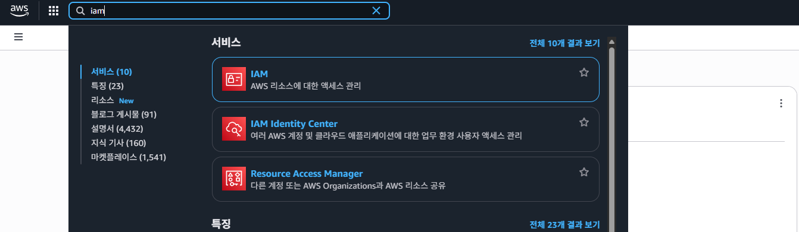
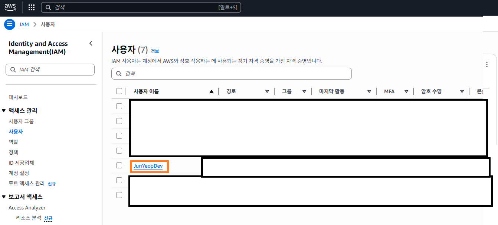
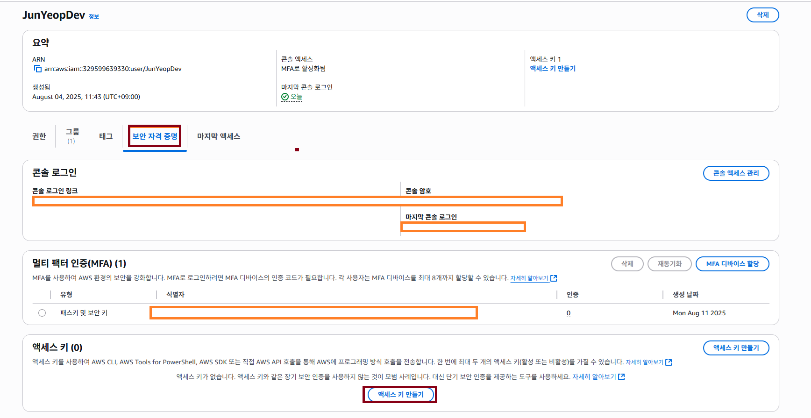
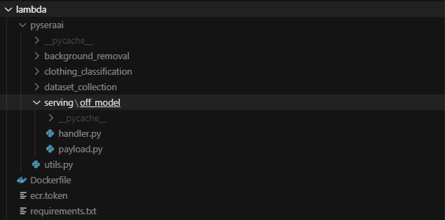

# Go to console IAM -> User



---



- Security Access Tab -> Create Access Key -> It gives you a .csv file with `access key and secret access key.`
  

# Creating Lambda Function for Model Serving

- I created a lambda directory with the following structure:



- Create lambda-supported docker image

```docker
FROM public.ecr.aws/lambda/python:3.11

COPY requirements.txt .
RUN python -m pip install --upgrade pip
ENV PIP_ONLY_BINARY=:all: PIP_NO_CACHE_DIR=1
RUN pip install -r requirements.txt
COPY pyseraai ./pyseraai
CMD ["pyseraai.serving.off_model.handler.handler"]
```

```sh
$ docker buildx create --use --name lambda-builder
$ docker buildx use lambda-builder
$ docker buildx build --platform linux/amd64 -t <acct>.dkr.ecr.ap-northeast-2.amazonaws.com/sera-fashion-api:lambda --push --provenance=false --sbom=false .
$ docker manifest inspect <acct>.dkr.ecr.ap-northeast-2.amazonaws.com/sera-fashion-api:lambda | findstr /R "mediaType os architecture"
        "mediaType": "application/vnd.docker.distribution.manifest.v2+json",
                "mediaType": "application/vnd.docker.container.image.v1+json",
                        "mediaType": "application/vnd.docker.image.rootfs.diff.tar.gzip",
                        "mediaType": "application/vnd.docker.image.rootfs.diff.tar.gzip",
                        "mediaType": "application/vnd.docker.image.rootfs.diff.tar.gzip",
                        "mediaType": "application/vnd.docker.image.rootfs.diff.tar.gzip",
                        "mediaType": "application/vnd.docker.image.rootfs.diff.tar.gzip",
                        "mediaType": "application/vnd.docker.image.rootfs.diff.tar.gzip",
                        "mediaType": "application/vnd.docker.image.rootfs.diff.tar.gzip",
                        "mediaType": "application/vnd.docker.image.rootfs.diff.tar.gzip",
                        "mediaType": "application/vnd.docker.image.rootfs.diff.tar.gzip",
                        "mediaType": "application/vnd.docker.image.rootfs.diff.tar.gzip",

```

- Create function with the image we made:

```sh
$ lambda create-function --function-name sera-fashion-api-img --package-type Image --code ImageUri=329599639330.dkr.ecr.ap-northeast-2.amazonaws.com/sera-fashion-api:lambda --role arn:aws:iam::329599639330:role/lambda-execution-role --timeout 60 --memory-size 2048 --region ap-northeast-2 --environment Variables={BUCKET_NAME=sera-s3-dev}
```

- Create HTTPS Endpoint:

```sh
$ aws lambda create-function-url-config --function-name sera-fashion-api-img --auth-type NONE --cors "AllowOrigins=[\"*\"],AllowHeaders=[\"*\"],AllowMethods=[\"*\"]" --region ap-northeast-2

{
    "FunctionUrl": "https://dvgh5fchll7kfbsfuq3pyeynwm0ignaa.lambda-url.ap-northeast-2.on.aws/",
    "FunctionArn": "arn:aws:lambda:ap-northeast-2:329599639330:function:sera-fashion-api-img",
    "AuthType": "NONE",
    "Cors": {
        "AllowHeaders": [
            "*"
        ],
        "AllowMethods": [
            "*"
        ],
        "AllowOrigins": [
            "*"
        ]
    },
    "CreationTime": "2025-08-26T17:07:49.274735806Z"
}
```

This created endpoint at "https://dvgh5fchll7kfbsfuq3pyeynwm0ignaa.lambda-url.ap-northeast-2.on.aws/"

```sh
$ aws lambda add-permission  --region ap-northeast-2   --function-name sera-fashion-api-img --statement-id FunctionURLAllowPublic --action lambda:InvokeFunctionUrl --principal "*" --function-url-auth-type NONE
{
    "Statement": "{\"Sid\":\"FunctionURLAllowPublic\",\"Effect\":\"Allow\",\"Principal\":\"*\",\"Action\":\"lambda:InvokeFunctionUrl\",\"Resource\":\"arn:aws:lambda:ap-northeast-2:<acct>:function:sera-fashion-api-img\",\"Condition\":{\"StringEquals\":{\"lambda:FunctionUrlAuthType\":\"NONE\"}}}"
}
```
