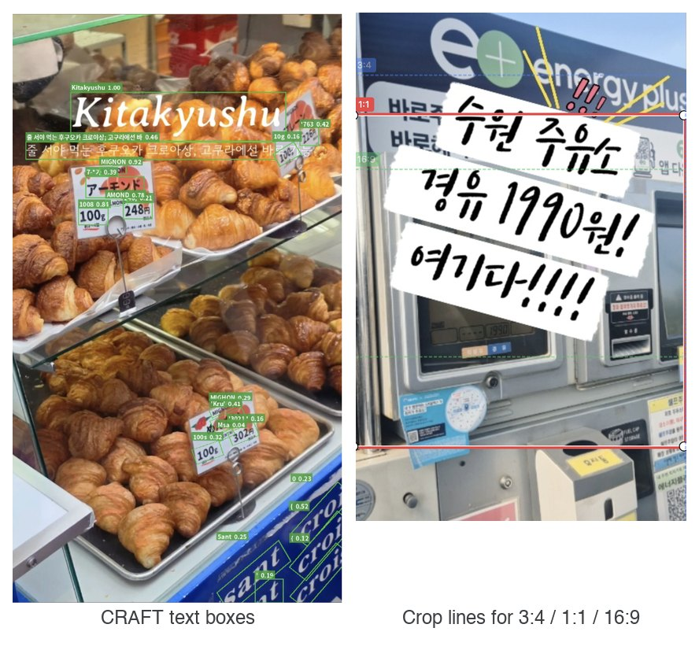
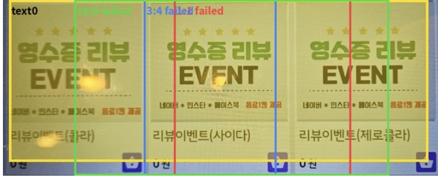

In 2025 I trained BestCrop, a model that recommends the best crop region of an image for blog thumbnails ([previous post](../recommending_the_best_crop_region/)). In 2026 the model moved into our team's image analysis service, and a lot more services started using it:

- The Naver app's Clip tab switched to 3:4 thumbnails made from BestCrop crops.
- The top slots of the Naver home feed started showing 1:1 BestCrop thumbnails.
- News photos in the home feed got BestCrop thumbnails from late August.

Every new service brought images the 2025 model had never seen: clip thumbnails with big titles and subtitles, news photos with logos and graphs, and collages of several photos. I kept improving the model and its post-processing through the year based on the failure cases each team sent us.

# 0. The Constraint: A Small Model

That service analyzes every image uploaded to blogs, clips, and other posts, so it has to handle tens of images per second on V100 GPUs. That meant BestCrop had to stay small: a fine-tuned vision backbone with a lightweight head.

The 2025 model worked well on blog photos, but on the new services it kept failing the same way: **it cut text.**

# 1. Not Cutting Text

When I looked at the failures, the model was trying to balance the subject, the text, and the box size at the same time, and a small model ends up with a box that cuts both the subject and the text.

So I simplified what the model has to learn, and **added logic on top of it that makes the crop avoid cutting off text**, using a small open-source text detection model.

Crops that cut through text went **from 23% to 7%** for 1:1, from 24% to 8% for 3:4, and from 32% to 10% for 16:9. The remaining failures were mostly images where text covers the whole frame, so no crop can avoid it:

# 2. Faces

Cutting someone's head off is the worst crop, so I wanted to detect heads. However, there weren't many head detection models we could use commercially, and face detectors stop at the forehead.

So I used a face detector and expanded each face box by 20% up, left and right to cover the head:

- If there is exactly one face, it's the most important region: the crop moves the minimum distance needed to contain it, and the text logic runs after.
- With two or more faces, the crop only moves when it cuts a face, within a 20% budget.

There are still known misses: faces turned far from the camera, helmets and masks, and cartoon or 3D avatar characters.

# 3. Collages

News and blog images are often collages of several photos, and the right crop depends on the layout. The planners gave us rules like: use the bigger panel if one dominates, pick the center panel when there are 3, keep the whole grid when there are 4 or more panels without people.

Rules like these are conditional, so I implemented them as post-processing instead of trying to teach them to the model:

- A recursive X-Y cut finds hard cuts and uniform gutters between panels, without any learned model.
- A panel counts as dominant when it's 1.5x bigger than the next one, and faces must stay at least 60% inside the crop.
- A single photo with the horizon near the middle looked like 2 panels, so I checked 1,953 news images and added a guard on the band height ratio that removed every false positive.

All 10 collage cases in the planners' list were fixed.

# 4. Evaluating Each Round

We didn't have a single metric for "good thumbnail", so each round was checked against the case lists the planners collected from real services:

- In July, a list of 52 news image cases: 20 improved, 5 partially improved, 27 not.
- In September, after the text and collage changes, a list of 60 cases: **40 improved, 0 partial, 20 not.**

By category, collages were 10/10, graphs and tables 3/3, and "the position alone makes the subject stand out" 5/6. The category that didn't move was TV captures with a person and a big caption (0/8): adding those samples to training didn't learn well, so it's still open.

As a sanity check, the median 1:1 crop covers 65% of the image area, and the average IoU with a plain center crop is 92.5% for 1:1 and 89% for 3:4. Most of the time BestCrop is a careful center crop, and the value is in the 10% of images where a center crop would cut a face, a title, or a collage seam.

# 5. Next: Game Broadcasts

At the end of September I started reusing the same idea for game broadcast clips on Chzzk, where the crop goes into a vertical template with the gameplay, the streamer cam, and the chat. A general game BestCrop trained on ~200 labeled frames worked on most games but missed crisp boundaries, so the next step is detecting the elements that must be kept (UI, characters, minimap) and handling them with post-processing, just like text and faces here.

BestCrop now serves 1:1, 3:4 and 16:9 crops for the Clip tab, the home feed, and news thumbnails, with text cuts reduced from 23% to 7% and 40 of the 60 planner cases fixed.
