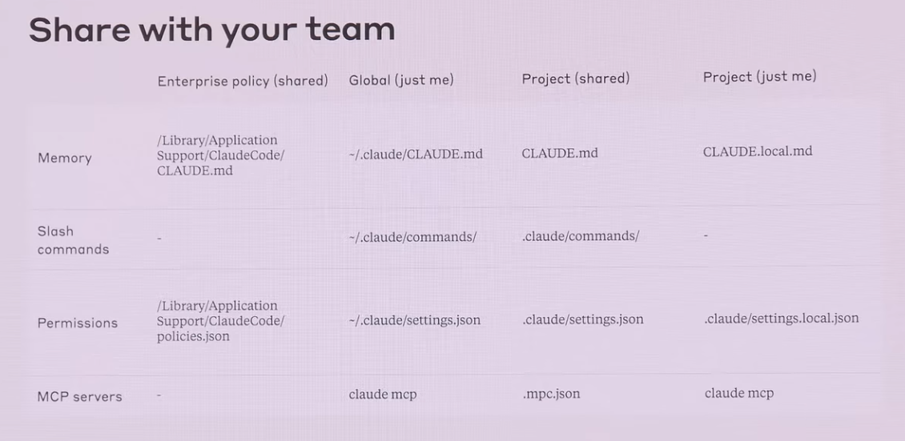
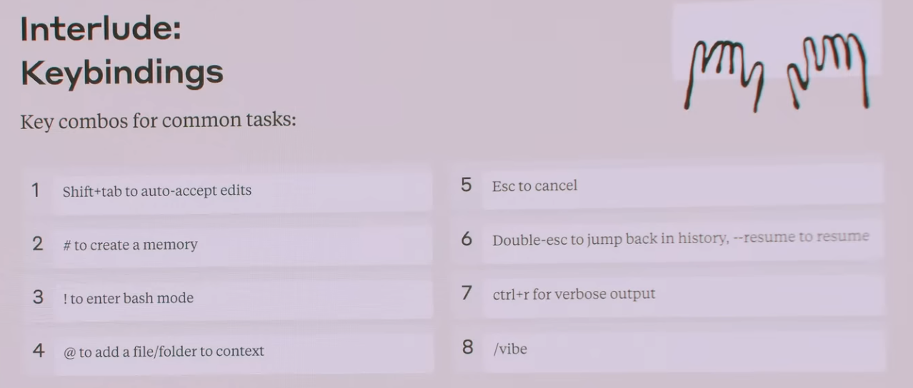

# Downloading Claude Code

```sh
# linux shell
curl -fsSL https://claude.ai/install.sh | bash

# powershell
irm https://claude.ai/install.ps1 | iex
```


# Basic Settings

## /permissions

- set tools that can and cannot be run

## /terminal-setup

**enables `shift-enter` for newlines**

## /login

authenticate in Claude account.

# Claude Context

## Common Bash Commands, Files, Style Conventions

### Shared Across All Projects

- `/<enterprise root>/CLAUDE.md`
- `~/.claude/CLAUDE.md`

### Checked in

- `<project root>/CLAUDE.md`

### Not Checked in

- `<project root>/CLAUDE.local.md`

need to manually check in

## Pull In Context On Demand

- `~/.claude/commands/foo.md` -> `/user:foo`
- `<project root>/.claude/commands/foo.md` -> `/project:foo`
- `a/commands/foo.md` -> `project:a:foo`
- `a/commands/foo.py` -> `@a/foo.py`

## Permission Setting For Sharing



## Keybindings



# Tips

## 1. Run /init immediately

## 2. Structure: What, Domain, Validation

- Validation is important for AI to self-improve

## 3. CLAUDE.md deep dive

- always do X, never do Y - documnet Claude's mistakes

* let Claude update CLAUDE.md

## 4. Get Used to the Primitive Composites

- Skills: recurring workflow (Ex) get article from hacker news + save it to local file)
- MCPs: give repo URL and tell claude to install this MCP.

## 5. /chrome connects browser

## 6. autoformat with PostToolUse

## 7. escape twice puts you back to previous state
