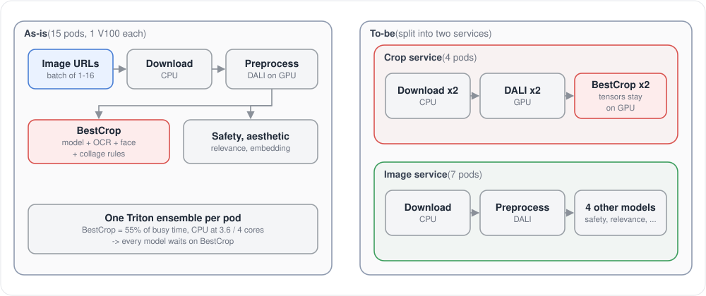
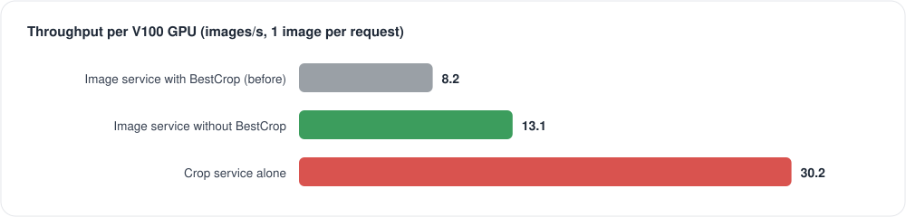

Our team runs an image analysis service: for every image uploaded to blogs, clips and other posts, it returns a safety score, an aesthetic score, title relevance, an embedding, and BestCrop crop boxes for thumbnails ([BestCrop in 2026](../bestcrop_2026/)). In 2025 we packed these models into one Triton ensemble per GPU to use our V100s better ([previous post](../scaling_blog_image_ai_models/)).

In 2026 BestCrop moved into this service, and as it grew (text detection, face detection, collage rules), the whole service got slower. Production requests started timing out in May, and we kept adding pods: 12 -> 16, and later 15 V100 pods. I worked on finding out why and fixing it.

# 0. The Setup

Each pod has 1 V100 32GB, 4 CPU cores, and one Triton ensemble:

- Download images on CPU
- Letterbox and normalize on GPU with DALI
- Run BestCrop, safety, aesthetic, relevance and embedding models
- A KServe transformer splits requests bigger than 16 images into chunks

Since everything runs in one ensemble, one slow model holds up every response.

# 1. First Attempt: More GPU

The obvious guesses were all about the GPU, so in May I tried them first:

- **A100 instead of V100**: we had idle A100s, so I ran 4 A100 pods next to 14 V100 pods behind the same route. There was no throughput difference between them.
- **TensorRT**: converting the models gave 2x+ per model on an H100, but only about 5% on a V100.
- **A smaller OCR model** for BestCrop's text detection was faster, but crop quality dropped.

Then I changed the CPU instead: going from 4 to 12 CPU cores raised throughput from 8 to 12 images/s, 1.5x. **The bottleneck wasn't the GPU, it was the CPU.**

Tuning the Triton config (instance counts, batch sizes) took a pod from 5 to 9 images/s with identical outputs, and I cut BestCrop's internal batch from 16 to 4 to fix an OOM. That got us through May, but every new BestCrop feature added more CPU work.

# 2. Measuring Where the Time Goes

In October I measured the queue and busy time of every model in the ensemble:

- BestCrop: 525 ms busy per image, **55% of all busy time**
- Safety: 111 ms (12%)
- Aesthetic: 78 ms (8%)
- Download: 78 ms (8%)
- Preprocess: 66 ms (7%)
- Relevance: 63 ms (7%)
- Embedding: 32 ms (3%)

And the CPU side of BestCrop was the slow part: the collage detection, text box post-processing, and the face detector's CPU steps.

## 2-1. Thread Oversubscription

One surprise was the thread count. The pod has a 4-core limit, but inside the container libraries saw all 56 cores of the node, so OpenMP, MKL and OpenBLAS each spawned threads for 56 cores. The pod was running 1,609 threads on 4 cores, and 68% of CPU scheduling periods were throttled.

Setting every library to 1 thread brought it down to 527 threads. Together with a few CPU -> GPU moves (collage lookup table 51.5 -> 19.6 ms/image, text detection on DALI's normalized output 16.1 -> 9.3 ms/image), throughput went up 29-59% depending on request size.

However, the pod was still using 3.62 of 4 cores, and more cores weren't an option for cost reasons. **As long as BestCrop shared a pod with the other models, its CPU work decided the speed of everything.**

# 3. Splitting BestCrop Out

So I split BestCrop into its own crop service and moved what was left of its CPU work to the GPU.

In the crop service:

- Download and DALI run 2 instances each, and tensors stay on the GPU between DALI and the model through DLPack. Only the boxes and the small amount of data needed for text and collage rules come back to the host.
- The collage strip table runs on GPU: 18.5 -> 4.9 ms/image.
- Text box post-processing is skipped when no text score passes the threshold, which is most images.
- Waiting for the GPU with a blocking CUDA event instead of spin-waiting cut CPU time from 11.6 to 0.75 ms/image. A device-wide setting would have done the same, but it slowed the face detector from 11.7 to 17.1 ms, so I applied it only where it was needed.

To make sure nothing changed, I ran 1,000 requests (1,042 images) through both versions: all 3,126 crop boxes were identical to the pixel.

# 4. Results

On the same V100 node:

- Image service with BestCrop inside: 8.2 images/s
- Crop service alone: **27.7-30.2 images/s** at 1 image per request, and up to 33.8 images/s at 7 images per request. Its CPU usage dropped to 2.2 cores with no throttling, and the GPU is now 85-100% busy, so the bottleneck finally moved from CPU to GPU.
- Image service without BestCrop: 13.1 images/s at 1 image per request, 26.8 at 7 images per request.

Since BestCrop now scales on its own, a BestCrop GPU does about 3.7x the images of an image service GPU before the split.

The image service went from 15 V100 pods to 7, plus 4 pods for the crop service, so the same traffic now runs on 11 V100s instead of 15.
