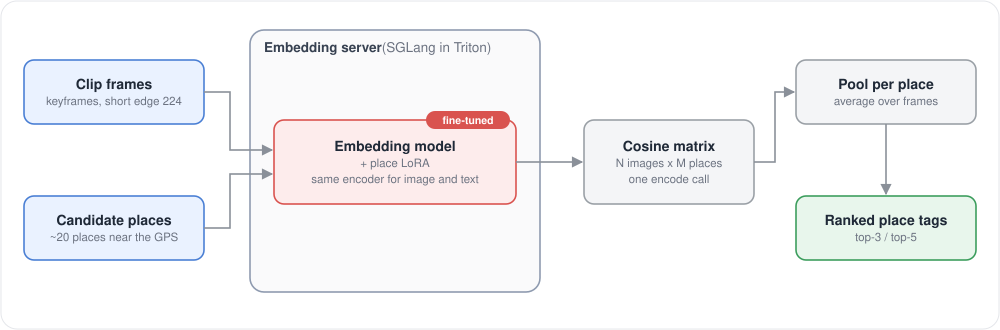

Creators on Naver Clip, Naver's short video service, can attach tags to a clip: a place they visited, a product they used, or an event they went to. Two features depend on how well we can match a clip's frames to a tag:

- **Place tag recommendation**: suggest the right place tag from the clip's frames, so creators don't have to search for it.
- **Tag abuse detection**: flag tags that don't match the content, like tagging a popular restaurant you never visited.

In late 2025 our team built VTA(Visual-Text Alignment), one general image-text embedding model meant to serve every image-text similarity task we had. In early 2026 a new open-source multimodal embedding model came out, built on a strong VLM, and I worked on fine-tuning it for place tags and building the inference server for it.

# 0. Where We Were

The place recommendation in production used an older image-text model. VTA v1 was our own model from 2025:

- Frozen VLM vision and text towers, mean pooling, and MLP projection heads trained with InfoNCE.
- 2.5 million image-text pairs from blogs, clips, and place/shopping/info tags.
- Task heads on top that take a weighted sum of 4 similarities (post image-tag thumbnail, image-text, text-image, text-text) for each task.

VTA v1 was general, but for places it had clear weak points: it missed place names written as text in the image (signboards, receipts, menus), and tourist attractions were much harder than restaurants and cafes.

# 1. Why a VLM-Based Embedding Model

The new model maps text, images, and videos into one embedding space using a VLM backbone with fixed instructions. There were three reasons to try it:

- Its foundation model is much stronger than the models behind our existing similarity models.
- Since the VLM reads text in images very well, it should help exactly where VTA v1 failed: signboards and menus.
- **The same encoder embeds both queries and documents**, so one model can serve image-image, image-text, and text-text similarity without separate towers.

# 2. A Benchmark Grounded on GPS

To compare models fairly, we built a benchmark from posts with real GPS coordinates:

- For each post, about 20 places near its GPS location are the candidates.
- The model scores every candidate place name against the post's images.
- A hit means the true place lands in the model's top-3 or top-5.
- About 190 test posts, evaluated with 1 to 5 images per post.

Without any tuning, the new model was slightly better than VTA v1 and slightly below the production model, and even its larger version was only about the same as production. **A bigger model alone wasn't enough, so I fine-tuned the smaller version on our place data instead of moving to the larger one.**

# 3. Fine-Tuning With LoRA

I used ms-swift's embedding training:

- Each image-tag pair is written in both directions: image anchor -> text positive, and text anchor -> image positive. For place training the text is just the place keyword.
- LoRA rank 8, alpha 32, learning rate 2e-5, InfoNCE loss with temperature 0.1
- 8 GPUs, bf16, FlashAttention, padding-free batching, DeepSpeed ZeRO-2, 1 epoch

There was one problem: the first estimate for training on the full place data was about 70 hours, and more than 200 hours for all data. ms-swift only cut the step time from 60 seconds to 40 seconds. So I trained the first model overnight on a subset, and its eval loss stopped at 2.5.

It turned out the slowness came from the environment, not the model: our old training image had a mix of outdated dependencies. **After moving to a clean base image, the same resources trained the full place data in about 1 hour**, and eval loss went from 4.5 (no tuning) -> 2.5 (subset) -> 1.6 (full place data).

# 4. Results

Top-3 / Top-5 accuracy with 1 image per post:

- Production model: 80.75% / 87.17%
- VTA v1: 79.14% / 86.10%
- New embedding model, larger version, no tuning: 82.89% / 88.77%
- New embedding model, smaller version, no tuning: 83.96% / 89.84%
- Fine-tuned on a subset of place data: 85.56% / 91.98%
- **Fine-tuned on the full place data: 90.91% / 94.65%**

With 2 images, the fully fine-tuned model reached 88.42% / 95.26% while the production model got 78.95% / 88.42%.

A few more findings:

- Full-data fine-tuning helped the most when there were only 1-2 images, which is the common case for clips.
- Averaging the similarity over images was more stable than taking the max.
- Mixing blog data into training didn't beat the place-only model on this benchmark.

# 5. Serving the Embedding Model

I built a place similarity v2 inference server around the model:

- A KServe transformer handles the API, and a Triton Python backend wraps an SGLang engine running in embedding mode (bf16, FlashAttention-3).
- Images are resized so the short edge is 224 before encoding.
- **Images and place names go into one encode call**, since the model gives the same embedding regardless of whether the input is a query or a document. This gives an N images x M places cosine matrix, which is then averaged per place.

The tradeoff was latency: the production model took about 200 ms on a T4, while the fine-tuned model took 600-700 ms on an H100 including image download and resizing. Sending pre-resized image bytes was expected to save about 200 ms of that.

# 6. Checking Abuse Detection on Posts

In March I was pulled back in to check whether the same model works for place tag abuse on regular posts, which look different from clips: most posts have no video, and usually just one relevant image like a menu photo.

There was no labeled set, so I built one from model outputs:

- Scored one week of posts with the model, about 12,850 posts in total.
- Split them into 10 percentile bins (bottom 1%, 1-5%, ..., top 1%) and sampled from every bin, so both obvious and borderline cases are covered.
- Labeled the samples as abuse / not abuse with a small local labeling tool I made (one key for each label).

The results showed that **image similarity alone isn't enough for posts.** At a threshold with 95% precision, adding the similarity between the post text and the tag raised F1 by about 8%, and image-only models couldn't even reach 90% precision once ambiguous cases were labeled as non-abuse.

# 7. Moving the Stage Server to a T4

Later in the year our A100s were needed elsewhere, so I moved VTA's stage server from an A100 to a T4. T4 doesn't support FlashAttention 2 or native bf16, so the model now checks the GPU's compute capability and falls back to fp16 + SDPA attention. Scores stayed the same (ex) 0.0057 on T4 vs 0.0058 on L40S), using 14.6GB of GPU memory, and the stage server's CPU/memory request went from 12 cores / 64GB to 4 cores / 16GB.

The fine-tuned model beat the production model by 7.5%p in Top-5 accuracy with 1 image, but abuse detection moved to a commercial multimodal model and I moved to the SPORTER project in February, so the place recommendation in production still runs on the older model while the v2 server and weights are handed over for the next round.
