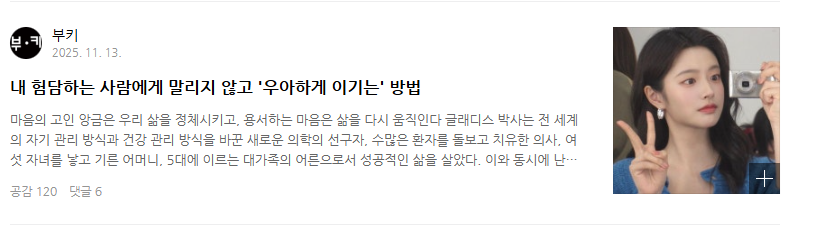
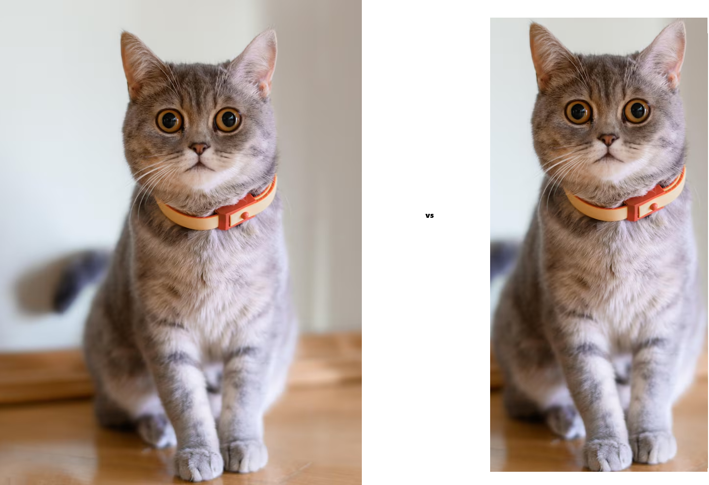
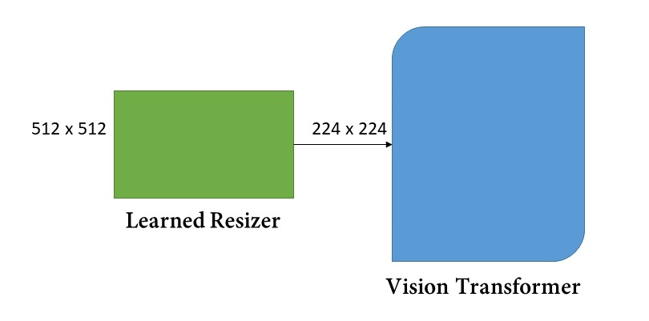
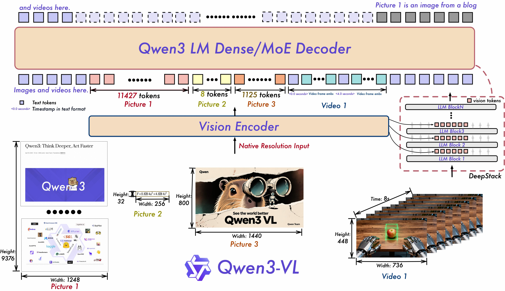
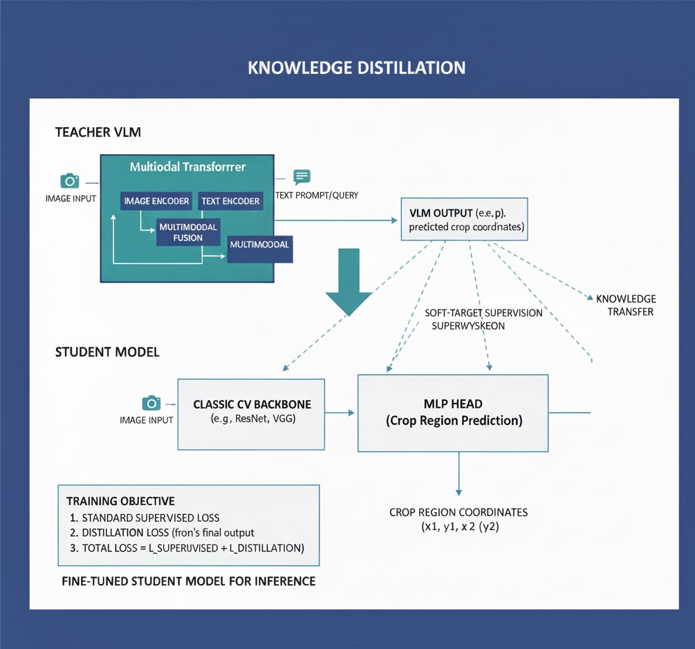
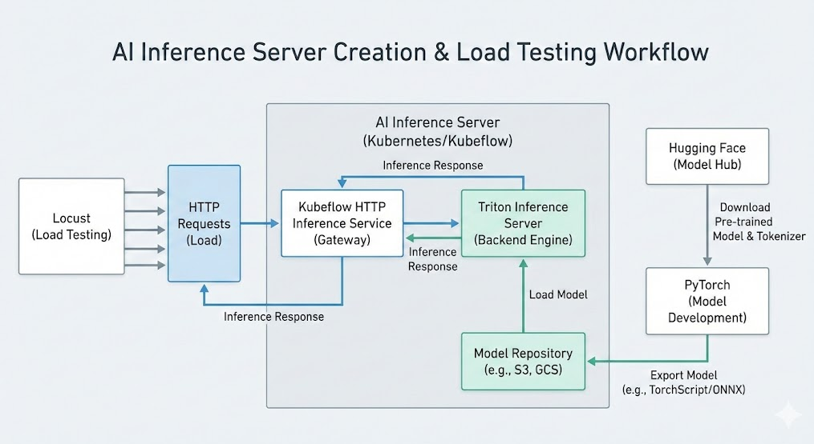

Naver's biggest asset is the rich amount of Korean reviews for all kinds of movies/products/restaurants users generate in their Naver blogs.

One of the most important part of a blog is its thumbnail. The thumbnail must be an interesting image that captures attention of potential readers.

Professional bloggers will always take a lot of time making their own thumbnail, but most of the users didn't have the time to put in that much effort for their thumbnail.

Naver supported "Auto Cropping", which recommended 1:1 and 16:9 aspect ratio crop proposals from images that the users used in their blog post, but it used a very simple algorithm, causing it to have several shortcomings, such as cutting off people in the image.

To provide better blog support for Naver Blog users, I went in a project as a Machine Learning Engineer to train an deploy an ML model that proposes the "best crop region" for a given blog image.

# 0. Characteristic of Crop Recommendation Problem

## 0-1. Saliency + Aesthtics

Crop recommendation task is a moderately hard task, which the model has to understand `what objects are in the photo`, and also `how to compose a crop area that looks appealing to people.`
Unlike object detection, if we crop an image to an object with the smallest fitting bounding box, the region will look too full, making the region less appealing.

We call this finding the `most salient` + `aesthetically appealing` area of an image.

## 0-2. Predicting the Box in the "Original Image" Coordinate

Since Vision Language Models use the transformer Vision models such as ViT as their backbone, they **actually don't actually look at the original image.**

- The image is resized to the model's required fixed size, or into factors of their patch size if they are using Swin-like architectures.

So when we ask for coordinates of crop bbox in the model, we actually get **coordinates in the resized area.**
This makes it hard to create a crop proposal for the original image coordinate, since teaching the model to take into account the original image's size is very difficult.

For example, if the original image's aspect ratio is 2:1, and the model resizes the image to 224x224 size(1:1 aspect ratio), then **the model actually has to recommend a 1:2 area in the "resized image" for it to be 1:1 in the actual image.**

# 1. Collecting Data From Big Open Source Models

The longest part of the project was to collect good labeled data for crop recommendation. There were two challenges:

- There wasn't a good commercial-free dataset that has the best `1:1` and `16:9` aspect ratio crop region labeled.
- Our company didn't allow using Commercial LLMs.

Since crop recommendation was more complicated that classic object detection or classification tasks, we needed a very good Model if we were to generate data from AI models.

So we decided to use the **Qwen3-VL's large-scale models to create labels for the image.**

- Even though Qwen3-VL is a very good model family, it still got crop regions wrong for 20% of the input images: giving too small bounding box, or focusing on the wrong subject.
- In Machine Learning, `Data Quality >>> Data Quantity`, so we spent a lot of time cleaning labels from the model output to ensure high data quality.

# 2. Training a Adequate Size Teacher Model

We collected about 10,000 decent quality images from the first step, but we found out that we needed more than 100,000 high quality data to train models in our target size(`< 1 Billion Parameters`).
We could have continued getting labels from our big Qwen3-VL models in Step 1, but there were two problems:

1. Big models took too long to inference such big sample number.
2. Even the big model was getting a lot of the crop proposal wrong, **especially for the 16:9 aspect ratio crop.**
3. Algorithmic cleaning of bounding box(filtering based on box size, location, ...) only gave "minimal quality validation" of the given labels. To get high quality data we had to manually filter the images, which was going to be way more costly as number of images scale.

To summarize, our main problem was that **Our teacher model wasn't "teaching" good enough.** So we decided to take it slow and use our 10,000 good quality data to **train a better fine-tuned Teacher Model.**

We trained different VLMs with our 10,000 data, and **succeeded fine-tuning a good teacher model with a couple billion parameters.**

# 3. Finally Distilling Knowledge to a 0.4B CV Model

Our VLM had a few billion parameters, which was our target model size but it was still not fast enough to use on production, and it had several limitations

- Since **VLM is autoregressive**, it took x5 longer to generate the output than a CV model of the same size. This speed was impossible to handle our 25 Million image requests per day traffic.
- Since VLMs generate texts, there was chance that **the model outputs malformatted texts, which will cause inference request to fail.**

Even so, we trained our teacher model on VLM because **it is usually the most sample-effective model to fine-tune.** We could control the training direction via prompt, which made it possible to fine-tune a good teacher model using only 10,000 images.

We collected 500,000 outputs from our teacher model, and did knowledge distillation on a Vision backbone with crop proposal MLP heads, which had 0.5B parameters.
We succeeded in training a model with 95% performance of our teacher model, while having `x10 faster inference time than our teacher VLM Model`.

# 4. Serving the Model on Inference Server

After training the model, we made an inference server like the diagram above:

- Kubeflow's InferenceService made of Triton Backend to handle HTTP requests
- Internal backend using Pytorch, Huggingface to perform inference
- Locust to load-test the service and tune serving parameters (max batch size, instances per gpu, number of pods)

After extensive tuning we were able to serve our model with 250TPS with only 4 V100 GPUs.
