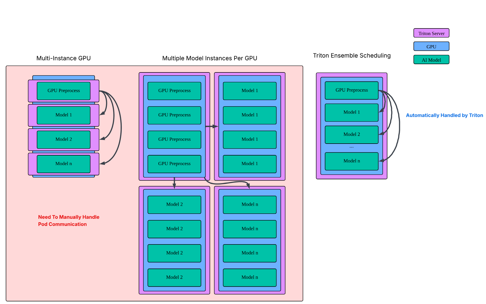
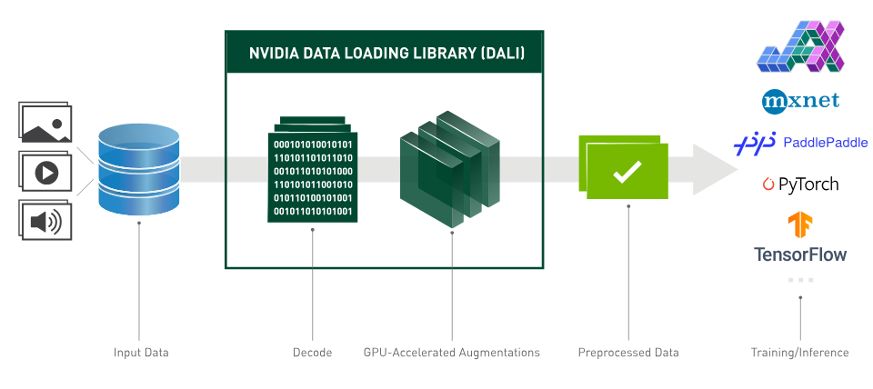

In my recent project I had to optimize handling 75 TPS

## Limitations:

### No MIG(Multi Instance GPU)

Our company's GPUs(V100) didn't support MIG, so our inference service pods needed to be assigned whole units of GPU.
Most of our

### Limited GPU Instances

Our team has 8 Nodes of V100 GPU, which was more than enough for a few years.

However, as the services our team provided kept increasing, we were running out of available V100 GPUs and it became apparent
that we have to use our limited resource more efficiently. All of our models are small models with parameter size less than a billion,
so these models, if used individually, weren't big enough to utilize one V100 to maximum capacity, meaning a lot of computation power was being wasted assigning one model for each GPU.

## Optimization

### Triton Ensemble Scheduling

The most needed change was to **pack as many models inside each GPU as possible**.

- With MIG being unavailable the easiest option was to **assign one model for each pod(GPU), and create as much instance of the same model as possible**
- The problem with this approach was **each pod had to communicate with other pods, which was hard to do for triton server.**
  - Also, our GPU preprocessing pod would have to send the preprocessed image as bytes to all other model pods, which will cause heavy communication cost.

- To solve this, we used Triton server's ensemble scheduling to pack all models into one single pod. This simplifies scheduling multiple models in the same GPU concurrently, and also decreased communication cost since all the models shared the same GPU memory.

### Fast Image Preprocessing using GPU

- Images are big 3-D arrays, just like tensors and model weights, so image preprocessing (standardization, letterboxing, ...) speed can be highly optimized by utilizing GPU.
- By using NVIDIA's DALI, we were able to speed up our image operations by x3.

Thanks to these two optimizations, we were able to **more than double our GPU utilization from 35% to 80%.** Before we were using 15 V100 GPUs to serve 4 AI models; now we only use 6 V100 GPUs even though the number of AI models we're serving increased to 7.
