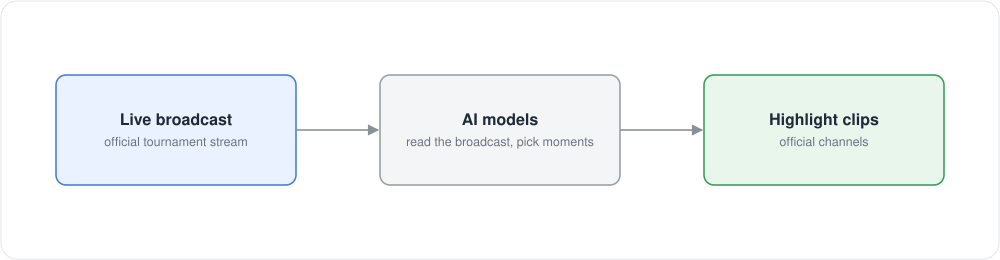
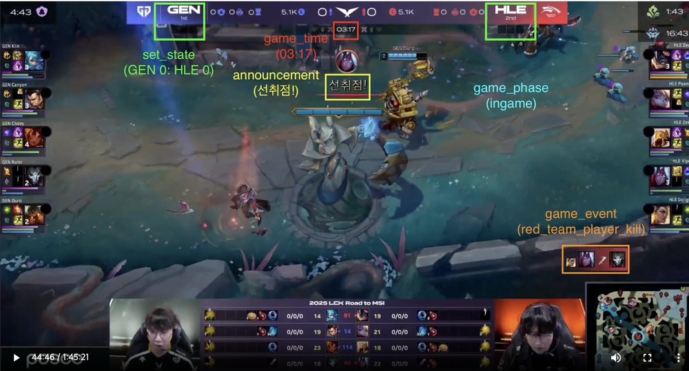
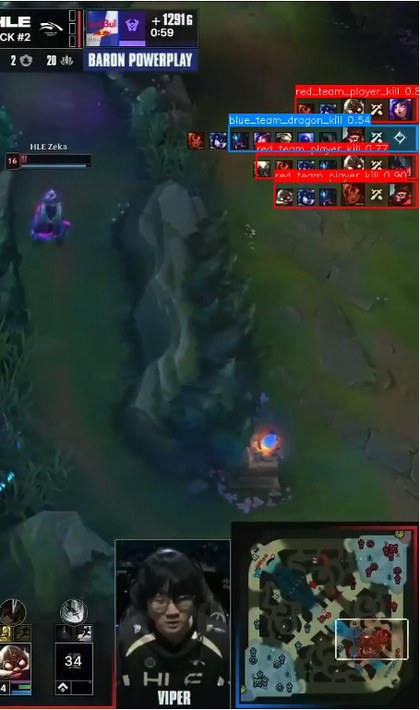
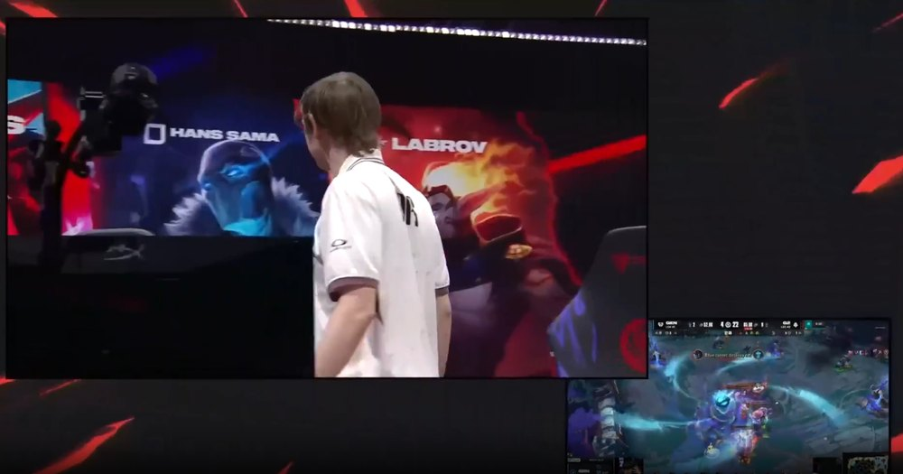

After the World Cup ([SPORTER 1](../sporter_worldcup_2026/)), the next big live events for SPORTER were League of Legends tournaments: the 2026 MSI (Mid-Season Invitational) in Daejeon from June 28 to July 12, and the 2026 Esports World Cup (EWC) in Paris in July and August.

SPORTER watches the live broadcast on Chzzk and cuts highlight clips automatically while the game is being played. For LoL, I started the research in March and built most of the in-house vision models: the kill feed detector, the scoreboard models, and the model that decides when a game ends and who won. I also worked as an on-call engineer during almost every MSI broadcast day and all 5 EWC LoL days.

# 0. Why LoL Is Harder Than Football

A football broadcast is one match. A LoL broadcast is a whole day:

- **One live stream carries every match of the day**, and every match is a best-of-3 or best-of-5 series. The system has to know which teams are playing and which set it is, all inside one stream.
- There are many more phases: pre-game, pick/ban (which sometimes restarts from the beginning because of a game bug), in-game with replays and pauses, post-game highlights, ads, and the analyst desk.
- Every tournament looks different. ex) At EWC the Korean analyst desk wasn't on site, so the post-game segment disappears, and the post-game highlights air without the "HIGHLIGHT" banner.
- A clip of the winning teamfight needs the result, so **the system has to decide that the game is over and which side won within about 1 minute.**

# 1. How Far Can Game Data Go?

The first idea was to skip vision and use an esports data feed that logs in-game events with rich metadata: player positions, team gold, and KDA at every event. I built a replay demo that rebuilds a game from the logs next to the broadcast, and also checked that the log times were accurate to about 1 second.

However, logs alone weren't enough for highlights:

- The logs are event-driven, not per tick. In the early game there can be a full minute without a log.
- Only ultimate abilities are logged, no regular skills or summoner spells. But a good highlight often starts with a flash or a gank arriving, which logs can't show.
- The feed had no data for EWC at all, and it can't give full team rosters.

I also tried a quick PoC that sends game events + shot boundaries + Korean STT to a commercial VLM and asks for highlight segments. After a few prompt iterations (keep clips compact around one event, snap to a shot boundary only within 5 seconds of the event) it made decent highlights. The order of importance was game events > shot boundaries > STT, and STT mostly helped the titles.

So the conclusion was: **we need our own models that read the broadcast itself**, especially for things logs can't give: the game state, the clock, the scoreboard, and the game result.

## 1-1. Dataset

To train these models I collected about 1,500 match IDs from LCK and international tournaments (2024-2026) and matched them to full broadcast VODs on Chzzk by title: 1,314 of 1,324 games were matched, giving us about 1,000 full games of broadcast + event pairs.

# 2. The Engines

Every few seconds the processor sends a new segment of the live stream to 6 vision engines and the STT engine, all served as KServe InferenceServices on H100s:

- **Context**: game state (in-game, pick/ban, replay, unknown), the game clock, and the center announcements, using a VLM + OCR at 1 fps.
- **GameEvent** (mine): the kill feed detector.
- **Shot boundary**: a shot boundary detection model.
- **Set score**: reads the series score from the broadcast UI.
- **Win / lose** (mine): game end and winner.
- **Screen**: camera location and players on screen.

The phase and set boundaries are built on top of these outputs, and a clip LLM picks moments, writes titles, and composes the clips.

# 3. GameEvent: Reading the Kill Feed

When a champion dies or a tower falls, the broadcast shows it in the kill feed on the right. I trained an object detector for the kill feed with 18 classes: 14 kill types (player kill, dragon, elder dragon, baron, herald, voidgrubs, scuttle crab, for each team) and 4 destroy types (tower and inhibitor, for each team).

- Fine-tuned from a COCO-pretrained detector on 1,444 labeled instances.
- **Precision 0.936, recall 0.932, mAP@50 0.971, mAP@50-95 0.819**, up from mAP@50 0.95 for the first version.
- Served as a TensorRT engine with NMS-free output, 1280 input, at 2 fps, with NVDEC decoding and letterboxing on the GPU.

The weak classes were the rare ones: games usually end before anyone takes the elder dragon, so there were only 2 training samples for it.

# 4. The Scoreboard

The top scoreboard has the team kill count, gold, towers, dragons, voidgrubs and heralds. Labeling all of that by hand was too much, so:

1. I gave a large VLM the top third of the frame and asked it to read the board. It got everything right on most frames except the dragon count.
2. I fixed the labels by hand, mostly the dragon counts.
3. The plain top-third crop was too noisy (side UIs, sponsor graphics), so I trained a board detector first. Training on LCK, First Stand and Worlds and testing on EWC 2024, with ~70% negative samples, it reached **mAP50 0.995, mAP50-95 0.959**. "A task with clear boundaries trains really well."
4. A VLM fine-tuned with LoRA reads the stats from the detected board.

# 5. Win / Lose: Deciding When the Game Is Over

Every Riot broadcast I checked (LCK, LCK Cup, MSI, Worlds, First Stand) shows the same thing when a game ends: about 1 second of the nexus exploding, followed by a diagonal split shot of the players.

So I trained a 3-class model on these frames: `notover`, `bluewin`, `redwin`. The first version got 160/165 frames right (96.97%). The 5 errors were all full in-game frames where the champion UI blurs as the nexus dies, and one of them called a game that wasn't over a red win, which is the worst possible mistake for a live system. I added more of those blurred frames and retrained.

The model in production was a **VLM fine-tuned with LoRA** on 5,114 labeled frames, served with SGLang:

- Instead of parsing generated text, the engine reads the logprobs of the first generated token for the 3 labels and turns them into probabilities.
- A frame is a hit when its probability is at least 0.997, and a side wins only with 2 or more hits.
- A warmup check fails the startup if the probabilities look uniform, which means the probability extraction is broken.

Two weeks before MSI, a test broadcast returned `notover` right at the nexus explosion. It turned out the serving prompt had a system message that wasn't in the training prompt. **That small train/serve skew was enough to change the output**, so I made the serving prompt byte-identical to training, raised the threshold from 0.95 to 0.997, and retrained. I checked the new version on 22 benchmark broadcasts before the real deploy on June 22.

# 6. MSI and EWC

During the events our team monitored every broadcast together with the clip team, and clips could be republished or hidden from an admin tool.

- At MSI, SPORTER made about 10 clips per set (about 11 for game 5 of the final).
- At EWC, SPORTER made 3,038 clips on the official channels between July 2 and August 3, across 5 games: Valorant 1,419, **League of Legends 622**, Apex Legends 380, Overwatch 314, and PUBG 303. For comparison, people had made 87 clips by hand for the 2025 EWC.

I also monitored Apex Legends and the PUBG finals. Battle royale games turned out to be a different problem: scoring is placement points + kills, so the context of a match (current standings, which round it is) matters more than any single kill.

# 7. What We Learned

After the events, I compared our clips with the clips the official LCK channels pick. SPORTER published far more clips, and they explained the flow of the game instead of showing the moments people actually share. From 2,551 official LCK shorts and 1,202 Chzzk LCK clips:

- Clips of 20 seconds or less got 2-2.5x the views of clips longer than 60 seconds.
- Punchline titles beat descriptive titles, and player names beat team names.

So the next goal became: **fewer clips with more impact** (5 or fewer per set), titles of 12 characters or less, and measuring impact from the live chat and the caster's voice ([SPORTER 3](../sporter_lol_worlds_watchalong_2026/)).

# 8. Follow-Up: Win / Lose on a Small CNN

In September the VLM win/lose model became a problem: when two live streams ran at the same time, it timed out. Since the task is a 3-class image classification with clear visual cues, I tried a small CNN instead.

- An ensemble of small CNN classifiers, much lighter than the VLM, on 360x640 inputs, with no flip augmentation since the victory overlay is different for each side.
- Accuracy 99.02% -> 99.32%, macro-F1 98.61 -> 99.03, errors 50 -> 35 out of 5,114 frames, and the game winner right in 342/342 games, in the study with a 20-model ensemble. The engine runs a 4-model ensemble.
- For a 1-minute window (120 frames at 2 fps), the whole request takes about 5.9 seconds, but 5.5 seconds of that is decoding the video. The models themselves take about 0.36 seconds.

The win/lose model no longer needs its own 2 H100 pods: it now runs inside the shared detect engine next to the kill feed detector and the shot boundary model.
