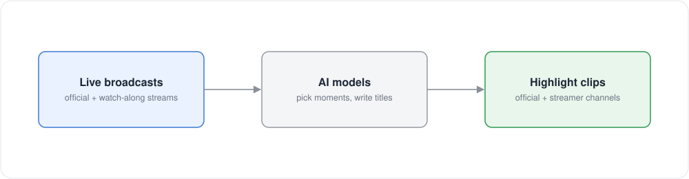

After MSI and EWC ([SPORTER 2](../sporter_lol_msi_ewc_2026/)), our analysis showed that SPORTER made too many clips that just explained the flow of the game, with long descriptive titles, while the clips people actually watch are short moments with short hook titles.

So from late July our team rebuilt SPORTER LoL around **impact**: publish only the moments that people react to, measured with data everyone can agree on (the live chat and the broadcast audio), and give them short hook titles. We also extended it to **watch-along** broadcasts for LoL Worlds 2026, which started on October 16.

My part was measuring impact from the chat and the audio, the reaction engines, the title model (Titlemaker) and the STT correction in front of it, the esports data integration, a load balancer for our inference engines, and an alerting system built from our operation incidents.

# 0. What Is a Watch-Along?

In a watch-along, a popular streamer re-broadcasts the official match on their own Chzzk channel, with their webcam and chat on top of it. For Worlds, SPORTER analyzed the official broadcast plus several watch-along streams at the same time, and posted watch-along clips to each streamer's own channel with a template that shows the match, the streamer's cam, and the chat.

It looks like the same video, but it's a different problem:

- **The audio is mixed.** The official casters are still in the stream, so the streamer's own voice and reaction get buried under the casters'.
- **Cost.** Running every vision engine on every stream wasn't an option, so the watch-along streams only run light engines. The facts of the game come from the official broadcast, and **the reaction comes from the streamer's own chat.**
- **Layouts change all the time.** Streamers turn off their cam, move or resize the chat box, or show a black screen.

# 1. Measuring Impact

I built a demo page that shows several chat and audio signals on the timeline of a full broadcast, and checked them against the moments the official LCK channel picked for its own clips. Some signals I expected to work didn't, and the ones that matched the official picks became our reaction engines.

One thing that mattered: **the amount of reaction depends a lot on who's playing**, so the score has to be relative within a set, not absolute.

The first versions of the reaction engines used an LLM to score the chat, but **the LLM call dominated the latency** and could take longer than the caller was willing to wait. So I removed it and kept the signals that worked, and the reaction engines now run on CPU only, without any GPU.

# 2. The Pipeline

Clip generation now runs once a set ends instead of continuously: the moments with the strongest reaction become candidates, and in-house LLMs decide which ones are worth a clip and write the title.

For Worlds, the models that used to call a commercial API were replaced by in-house **LLMs fine-tuned with LoRA** by my teammates, and the commercial model is still kept as a fallback.

# 3. Titlemaker: 2-3 Word Hook Titles

The main viewers of LoL clips are in their 20s and 30s, and they prefer short titles that make you curious. When we looked at LCK YouTube shorts, short hook titles clearly did better than long descriptive ones.

## 3-1. Data and Model

- **Input**: the casters' commentary (STT) around the moment. I decided not to use the viewers' chat at all: a slur from the chat in a published title would be much worse than a slightly boring title.
- **Data**: an LLM couldn't classify good titles with examples, so I hand-labeled titles for clips SPORTER had made. Training data was scarce, so I also built a local simulator of our clip pipeline to create moments without waiting for a live match.
- **Model**: a large open-weight LLM fine-tuned with LoRA. The task was too hard for the smaller models we used elsewhere. It didn't fit on one GPU for training at first, so I used DeepSpeed ZeRO-3 and installed Flash Linear Attention for the model's linear attention layers, which cut one step's memory from 16.47GB to 5.18GB.
- After a few epochs it wrote LoL-style titles of 2-3 words well. To get more data I let the model suggest more titles per clip and set up an accept/reject/edit review of its suggestions.

Compared with a prompt-tuned commercial model the titles were about as good, and **with similar quality, the in-house model is the one we can keep training**, so we went with Titlemaker.

## 3-2. Rules Around the Model

Most of the work after the model was rules: the title has to fit the template, use only the characters we allow, use short player names, and pass a banned word and profanity check. When a title fails, it's regenerated instead of published.

# 4. Fixing the STT Before It Becomes a Title

The biggest source of bad titles was the STT: when the speech recognition gets a champion or player name wrong, the title model copies the mistake. ex) Trundle was recognized as "Trumd".

So I added an **STT fixer LoRA** on the same base model, trained on auto-labeled corrections that I checked by hand. Later I added a step in front of it that sends the clip's audio to a commercial multimodal model, falling back to the STT fixer if it fails. The hard part was keeping the corrected lines aligned with the original ones, especially in watch-along streams where two voices overlap.

## 4-1. Several LoRAs on One GPU

The moment check, the STT fixer and Titlemaker all share one base model, and the adapter is picked per request. **This took 3 GPUs down to 1.**

# 5. Keeping the Engines Busy

During tests, some requests took far too long while other pods of the same engine were idle. Each pod handles one request at a time, and the load balancer's routing is only probabilistic, so **almost all of the slow requests were waiting while a sibling pod was idle.** It was an assignment problem, not a capacity problem.

So I wrote a dispatcher that sends each request to an idle pod and falls back to normal routing when every pod is busy. It now runs in front of every esports engine.

# 6. Operations and Alerts

Through the Asian Games and Worlds, **almost every incident that needed a person was found by someone watching the live, not by an alert.** Some of them were the kind you only find live, like a library update that made a job fall behind, or a few seconds of silent broadcast that changed how the chat reacted.

From these incidents I drafted a set of alerts that would have caught most of them, and implemented them in the clip pipeline at the end of October.

Worlds runs until November 15, and SPORTER is publishing impact-based clips with hook titles for the official broadcast and the watch-along streams every match day, and the alerts are the next step toward not needing a person on every match.
