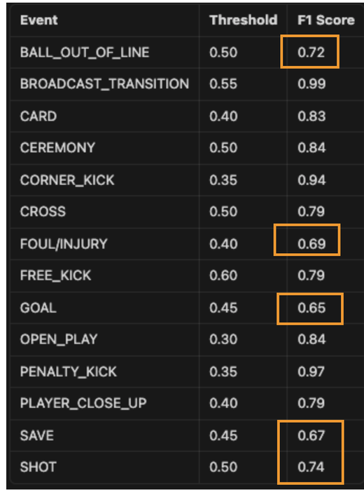
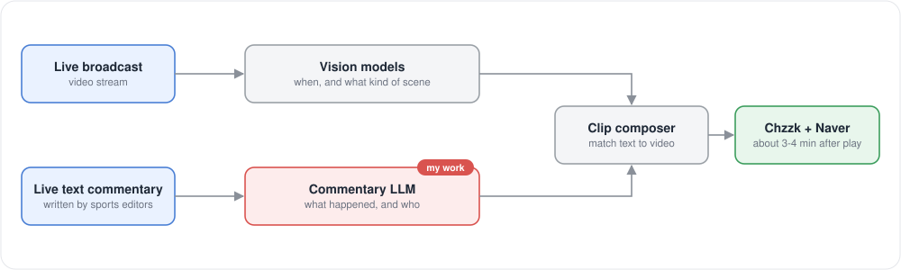

The 2026 FIFA World Cup was streamed live on Chzzk, Naver's streaming platform, and our team built SPORTER, a system that watches a live sports broadcast and cuts highlight clips while the match is still being played.

The goal is simple to say: when a goal goes in, a clip of that goal should be on Chzzk and the Naver Sports match page a few minutes later, with a title that says who scored, without anyone editing it by hand. The World Cup was SPORTER's first big live event, with 104 matches in 39 days.

I worked on the scene understanding part of SPORTER as a Machine Learning Engineer: I tested which models can understand a football scene, built training data for our in-house action spotting model, and built the LLM engine that turns live text commentary into structured events.

# 0. What a Highlight System Needs to Know

To cut a clip automatically, the system has to answer three questions for every few seconds of the broadcast:

- **What** happened? (a shot, a save, a goal, a corner kick)
- **Who** did it? (the shooter, the goalkeeper, the player who gave the assist)
- **When** exactly did it start and end, without the replays?

We had two sources, and each one only answers part of it:

- **The video** knows exactly when something happened. However, recognizing what happened from 3 seconds of footage is hard: a goal and a save look almost the same until the ball crosses the line.
- **The live text commentary** is written by Naver Sports editors for every event (ex) "X's shot from the left of the box is saved by goalkeeper Y"), so it knows what happened and who did it. But its timestamps are coarse and it arrives late.

So the system had to combine both, and most of my work was figuring out how much each side could do.

# 1. Can a VLM Understand a Football Scene?

Before building anything, I wanted to know how far a commercial VLM can go. I made an eval set from 3 full matches of the Korean national team, labeled every 3-second segment myself, and asked a commercial VLM to classify each segment into one of 24 classes: 19 football actions (shot, save, corner kick, throw-in, ...) and 5 broadcast classes (replay transition, advertisement, crowd shot, ...).

The first result was **64.34%**. Easy classes were fine (substitution 7/7, free kick 10/11), but the classes we cared about most were the worst: save 0/8, goal 1/6, header 0/5. The model kept calling saves goals, and throw-ins looked like open play to it.

From there I changed one thing at a time on the same benchmark:

- **Drop classes the video doesn't have to answer.** Goal and save can be heard from the commentator, tackle was merged into foul, and headers don't matter for clips. I also asked the model to list everything it sees and picked one label with a rule-based priority -> 81.20%
- **A larger model tier from the same vendor** -> 79.49%, no better than the faster one.
- **Frames instead of video.** 2 fps frames -> 82.91%, 4 fps frames -> 84.62%. It's probably because the model spends far more tokens on an image than on the same frame inside a video.
- **4 fps frames + list everything + priority** -> **87.93%**
- **Adding the commentator's speech (STT)** -> 88.8%, too small a gain for the extra input.

So with prompt work alone we went from 64.34% to 87.93%. At ~90% the model was good enough to be a labeler, so instead of calling it live, we used it to label training data for our own model.

# 2. Building Our Own Action Spotting Model

## 2-1. Open Models Didn't Work Out of the Box

I tried open models first:

- **An open-weight VLM** on video wasn't good enough, and **a bigger VLM fine-tuned with LoRA** was better but still not there. It was also slow for a live system: 2.04-4.82 seconds per clip on 1 GPU, 1.15-2.70 seconds on 2 GPUs, and 0.74-1.61 seconds on 4 GPUs. 1 -> 2 GPUs helped a lot, but after that the efficiency dropped.
- **A public action spotting model** from the SoccerNet challenge caught only 3 scenes in 500 frames of our broadcast, and all 3 were wrong.

So we decided to train our own action spotting model. A teammate designed and trained this model. My part was the training data and a later retraining round.

## 2-2. Training Data From the Commercial VLM

Labeling football actions by hand is slow, so I cut past matches into 3-second chunks and used the tuned VLM setup from Step 1 to auto-label them. Together with human labels from our labeling tool we had about 15,000 samples, and trained the model on them.

The first version reached **macro F1 0.856 and mAP 0.890** on a held-out set of 665 clips.

## 2-3. Retraining With New Classes

In March I retrained the model with 3 more classes we needed for clips: `CARD`, `CEREMONY`, and `FOUL/INJURY`. Macro F1 went down to **80.4%**, mostly because foul and injury scenes are hard to tell apart from normal play.

The weak classes were the important ones: `GOAL` 0.65, `SAVE` 0.67, `FOUL/INJURY` 0.69, `SHOT` 0.74. I also tried a separate model trained only on shot/save/goal, which didn't help, and with ~15,000 samples a bigger backbone wasn't an option either.

To summarize, **the vision model was good at telling *when* something happened and what kind of broadcast scene it was, but it couldn't reliably tell a goal from a save.** For that we needed the text commentary.

## 2-4. Replay Wipes

When broadcasters switch into a replay, they play a short animated wipe. A clip shouldn't show the same goal twice or cut in the middle of a replay, so the system has to know where replays start and end.

Every competition has its own wipe, so I collected wipe styles from several competitions and trained the model to detect them.

In the action model, the `BROADCAST_TRANSITION` class that covers these wipes was the easiest class, at 0.99 F1.

# 3. Reading the Live Text Commentary With an LLM

## 3-1. Why an LLM

Naver Sports editors write a line for every event in a match. Turning these lines into structured events looks like a job for rules, but there were three problems:

- The format and event codes are different for every league. ex) K League sends its own event codes, and it may never send a penalty goal event at all.
- One sentence can hold several events and players. "X's shot from the left of the box is saved by goalkeeper Y, assisted by Z's through pass" is a `SHOT`(shooter X, assist Z, goalkeeper Y) and a `SAVE`(goalkeeper Y, shooter X).
- Player names in the text have to be mapped to player IDs from the lineups.

So I built an LLM engine for it. The input is one commentary line, the event type the source attached to it, and both lineups. The output is a list of events (19 event types like `GOAL`, `OWN_GOAL`, `SAVE`, `PENALTY_GOAL`, `GOAL_OVERTURNED`) with the players involved and their roles (12 roles like `SCORER`, `ASSIST`, `GOALKEEPER`, `FOULER`).

## 3-2. Picking the Model Size

- **An open-weight LLM without tuning** already got about 89% of the commentary lines right, so I used it to auto-label commentary data.
- I fine-tuned **a smaller LLM from the same family with LoRA** on that data to make it faster. Outputs that parsed were almost always right, including player names, but **20% of the outputs weren't valid JSON because the small model kept reasoning even with thinking turned off.**
- So we moved back up to **the larger LLM + LoRA**, with the LoRA merged into the base weights for serving.

## 3-3. Serving

In April I moved the engine to a faster LLM serving engine. It retries when the output is malformed, and ambiguous player names are left empty instead of guessed.

I also added unit tests to the warmup step. Every fix the clip team asked for became a test case, and **if any test fails, the deployment fails**, so a new model or prompt can't silently bring back an old bug.

## 3-4. The Timing Problem

The text commentary tells us what happened, but not when to cut. It logs the referee's decision, and its clock is not the broadcast clock. ex) The commentary can log a corner kick at 45+5, while the ball went out more than a minute earlier.

It also arrives late. When we measured on EPL matches, only 52.1% of commentary events had arrived within 20 seconds, and 80% of them took about 56 seconds.

So the system has to match each commentary event to the right part of the video, and wait for events that arrive late.

# 4. Putting It Together

Vision models read the live broadcast, the LLM reads the live commentary, and the clip composer matches the two to decide cut points, titles and thumbnails before publishing to Chzzk and Naver.

**Text gives the *what* and *who*, and video gives the *when*.**

# 5. Fixes During the Tournament

The relay engine went live on 2026-05-29, after testing on live EPL, MLS and K League matches. Most of the fixes after that were about football rules rather than the model:

- **Penalty goals** were added as their own event.
- **A shot that names the goalkeeper** must also produce a `SAVE` event, so the save clip gets the goalkeeper's name.
- **Own goals** came out as `GOAL` -> added `OWN_GOAL`, and split VAR checks into `GOAL_CONFIRMED` and `OWN_GOAL_CONFIRMED`. There were only 4 VAR own goal lines in my data, so this had to be handled carefully.
- **"VAR: another decision was cancelled"** was turned into `GOAL_OVERTURNED` during a World Cup match. These lines were too rare in the training data for fine-tuning to fix, so the engine now skips them (about 0.3% of all lines). I replayed every commentary line since the opening match to check that nothing else changed.

Each of these became a warmup test case, so none of them came back.

# 6. Results

- On the opening day, SPORTER made 70 clips for the 2 matches, about 2.6x the number of clips that the broadcasters' editors made by hand.
- The time from a play to its clip being on the service was 198.8-236.8 seconds (3.3-3.9 minutes).
- By the end of the group stage SPORTER had published 1,259 clips over 39 matches.

SPORTER cut highlight clips for all 104 World Cup matches automatically, with our team only monitoring the live output, and the same system moved on to esports for MSI and EWC right after.
