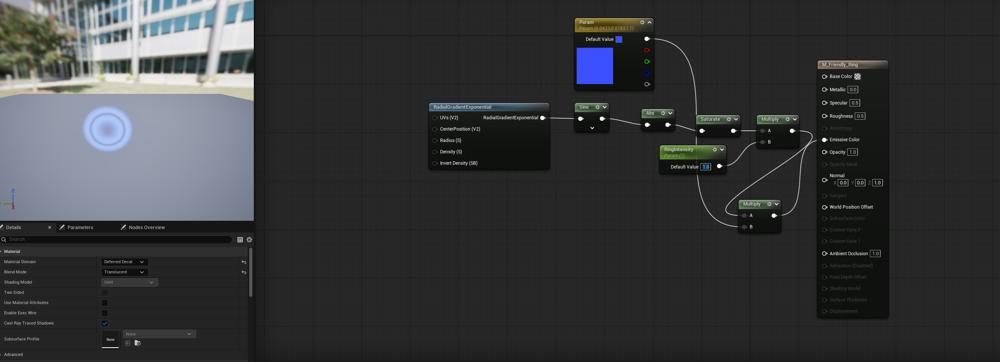
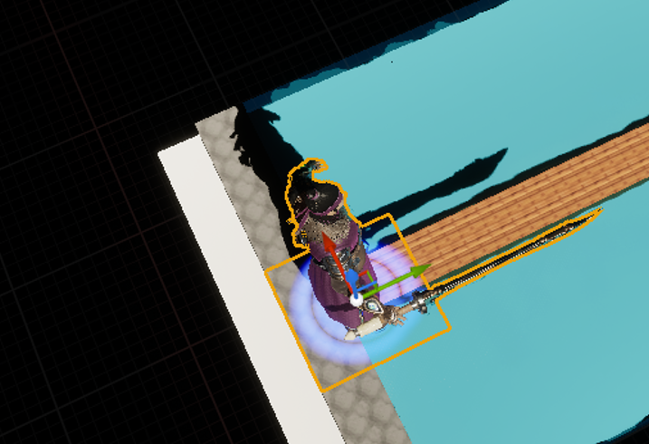

We can create simple materials like rings using only materials editor. I'm going to record some basic shapes that can be made so that I can search them later.

# Creating Selection Ring

- This can be used as a UI to show selected units.

