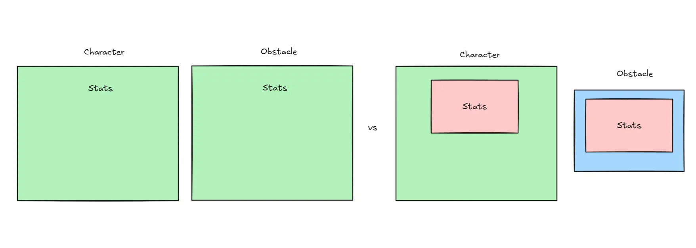

I needed to add common stats such as HP, movement, attack for my tactics game.

The simplest way is to put them directly in the `Character` Class, but there is a better way: `Actor Component`

## Modularity - Why Actor Component is a Better Choice

Putting stats directly in character will make it hard to reuse these stats in other classes.

- We might have classes other than characters that want to use this class, but if we have these stats in Character, we “HAVE TO DECLARE THEM AS CHARACTER”, which means we have to load all other heavy implementations the Character class has, slowing down the game.

# Creating UnitBaseStats

Tools -> Create New C++ Class -> `ActorComponent`

