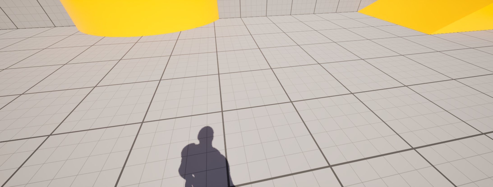
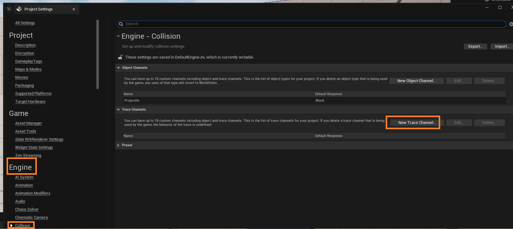

Creating a Basic First-Person Character

# 1. Making A Character With Basic Move/Look

```cpp
#pragma once

#include "CoreMinimal.h"
#include "GameFramework/Character.h"
#include "Logging/LogMacros.h"
#include "IRLPlayableCharacter.generated.h"

class UInputComponent;
class USkeletalMeshComponent;
class UCameraComponent;
class UInputAction;
struct FInputActionValue;

DECLARE_LOG_CATEGORY_EXTERN(LogTemplateIRLPlayableCharacter, Log, All);

/**
 *  A basic first person character in the IRL Mode.
 */
UCLASS(Abstract)
class AIRLPlayableCharacter : public ACharacter
{
	GENERATED_BODY()

	UPROPERTY(VisibleAnywhere, BlueprintReadOnly, Category="Components", meta = (AllowPrivateAccess = "true"))
	UCameraComponent* CameraComponent;

protected:
	UPROPERTY(EditAnywhere, Category ="Input")
	class UInputAction* MoveAction;

	UPROPERTY(EditAnywhere, Category ="Input")
	class UInputAction* LookAction;

public:
	AIRLPlayableCharacter();

protected:
	void MoveInput(const FInputActionValue& Value);

	void LookInput(const FInputActionValue& Value);

	void DoMove(float Right, float Forward);

	virtual void SetupPlayerInputComponent(UInputComponent* InputComponent) override;

public:
	/** Returns first person camera component **/
	UCameraComponent* GetCameraComponent() const { return CameraComponent; }
};
```

- `IRLPlayableCharacter.cpp`

```cpp
// Copyright Epic Games, Inc. All Rights Reserved.

#include "IRLPlayableCharacter.h"

#include "Camera/CameraComponent.h"
#include "Components/CapsuleComponent.h"
#include "Components/SkeletalMeshComponent.h"
#include "EnhancedInputComponent.h"
#include "InputActionValue.h"
#include "GameFramework/CharacterMovementComponent.h"
#include "Animation/AnimInstance.h"
#include "Components/SkeletalMeshComponent.h"
#include "RaceToWorldFirst1.h"
#include "UObject/Object.h"

AIRLPlayableCharacter::AIRLPlayableCharacter()
{
	GetCapsuleComponent()->InitCapsuleSize(55.f, 96.0f);

	USkeletalMeshComponent* CharacterMesh = GetMesh();

	CameraComponent = CreateDefaultSubobject<UCameraComponent>(TEXT("First Person Camera"));
	CameraComponent->SetupAttachment(CharacterMesh, FName("head"));
	CameraComponent->SetRelativeLocationAndRotation(FVector(0.0f, 10.0f, 0.0f), FRotator(0.0f, 90.0f, -90.0f));
	CameraComponent->bUsePawnControlRotation = true;
	CameraComponent->bEnableFirstPersonFieldOfView = true;
	CameraComponent->bEnableFirstPersonScale = true;
	CameraComponent->FirstPersonFieldOfView = 70.0f;
	CameraComponent->FirstPersonScale = 0.6f;

	CharacterMesh->FirstPersonPrimitiveType = EFirstPersonPrimitiveType::WorldSpaceRepresentation;
	CharacterMesh->SetRelativeLocationAndRotation(FVector(0.0f, 0.0f, -90.0f), FRotator(0.0f, 0.0f, -90.0f));


	GetCapsuleComponent()->SetCapsuleSize(34.0f, 96.0f);

	GetCharacterMovement()->BrakingDecelerationFalling = 1500.0f;
	GetCharacterMovement()->AirControl = 0.5f;
}

void AIRLPlayableCharacter::SetupPlayerInputComponent(UInputComponent* PlayerInputComponent)
{
	if (UEnhancedInputComponent* EnhancedInputComponent = Cast<UEnhancedInputComponent>(PlayerInputComponent))
	{
		EnhancedInputComponent->BindAction(MoveAction, ETriggerEvent::Triggered, this, &AIRLPlayableCharacter::MoveInput);
		EnhancedInputComponent->BindAction(LookAction, ETriggerEvent::Triggered, this, &AIRLPlayableCharacter::LookInput);
	}
	else
	{
		UE_LOG(LogRaceToWorldFirst1, Error, TEXT("'%s' Failed to find an Enhanced Input Component! This template is built to use the Enhanced Input system. If you intend to use the legacy system, then you will need to update this C++ file."), *GetNameSafe(this));
	}
}

void AIRLPlayableCharacter::DoMove(float Right, float Forward)
{
	if (GetController())
	{
		AddMovementInput(GetActorRightVector(), Right);
		AddMovementInput(GetActorForwardVector(), Forward);
	}
}

void AIRLPlayableCharacter::MoveInput(const FInputActionValue& Value)
{
	FVector2D MovementVector = Value.Get<FVector2D>();

	DoMove(MovementVector.X, MovementVector.Y);
}

void AIRLPlayableCharacter::LookInput(const FInputActionValue& Value)
{
	FVector2D LookAxisVector = Value.Get<FVector2D>();

	if (GetController())
	{
		AddControllerYawInput(LookAxisVector.X);
		AddControllerPitchInput(-LookAxisVector.Y);
	}
}
```

# Make Blueprint Class

After compiling, create a Blueprint Class that inherits `IRLPlayableCharacter`

[blueprint_class](./bp_class.png)

- Set its skeletal mesh to `SKM_Manny_Simple`
- Set its Look/Move input action to `IA_Look` and `IA_Move`

[inputs](./bp_move.png)

- Set animation blueprint to `ABP_Unarmed`

[anim](./anim.png)

- Now we have a default character


- Set this as default pawn and run the game, and we have a first-person character that moves and can change view by moving mouse.



# 2. Making Interaction System

Now to make my character interact with other NPCs, I'm going to override the tick function to

1. **update the trace line and return the first NPC hit as the current target.**
2. Be able to interact with the current target NPC if the distance is close enough(10m).

## 2-1. Add Custom Trace Channel

- Edit-> Project Settings -> Engine -> Collision



- Create a new trace channel "CharacterInteraction", Default Response to "Block"

## 2-2.
