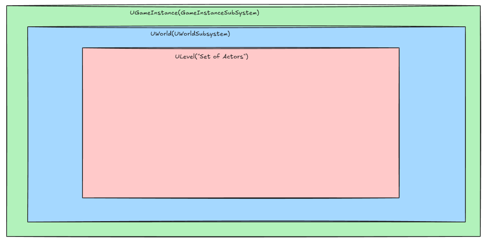

# 1. TObjectPtr<T>

Unreal Engine GC-safe Pointer Wrapper for Unreal UObjects. More safer, little slower(small indirection) than `T*`

- **Use `UPROPERTY + TObjectPtr` for class/struct members that must be tracked by GC**
- Use `T*` for locals, function params/returns, temporary variables

# 2. TMap<K, V>, TInstnacedStruct, UDataAAsset

- TMap: Hashmap implementation for Unreal Engine.
- TInstancedStruct: If I make a Struct in Unreal Engine, we can't see it in Unreal Editor because **Struct is not a UObject.** TInstancedStruct wraps our Struct to make a UObject, which we can see and modify in our UE Editor.
- UDataAsset: The dataclass of Unreal Engine. Good for storing static data that will be used in the game.

```cpp
/**
 * Defines All the types of Interactions in IRL Mode.
 * These interactions are stored in IRL Actors and are activated when the player presses "Interact" Button to the actor.
 */
USTRUCT(BlueprintType)
struct FIRLInteraction
{
	GENERATED_BODY()

	UPROPERTY(EditAnywhere, BlueprintReadWrite)
	FName Id;

	UPROPERTY(EditAnywhere, BlueprintReadWrite)
	FString Text;

	UPROPERTY(EditAnywhere, BlueprintReadWrite, meta=(GetOptions="GetInteractionIds"))
	FName NextId;
};

/**
 * The most common interaction: text conversations. Made in nodes, where each node is one unit of text(in one screen)
 */
USTRUCT(BlueprintType)
struct FConversation: public FIRLInteraction
{
	GENERATED_BODY()

	UPROPERTY(EditAnywhere, BlueprintReadWrite)
	FString CharacterName;
};


// Usage ex)
#pragma once

#include "CoreMinimal.h"
#include "GameplayTagContainer.h"
#include "IRLInteractions.h"
#include "Engine/DataAsset.h"
#include "StructUtils/InstancedStruct.h"
#include "IRLInteractionDatabase.generated.h"

/**
 * Defines the interaction event of one actor in different parts of the story.
 */
UCLASS()
class RACETOWORLDFIRST1_API UIRLInteractionDatabase : public UDataAsset
{
	GENERATED_BODY()

public:
	UPROPERTY(EditAnywhere)
	TMap<FName, TInstancedStruct<FIRLInteraction>> AllInteractionsDatabase;
	TMap<FGameplayTag, TInstancedStruct<FIRLInteraction>> InteractionInEachLevel;

	UFUNCTION()
	TArray<FName> GetInteractionIds() const
	{
		TArray<FName> Out;
		Out.Add(NAME_None);

		for (const TPair<FName, TInstancedStruct<FIRLInteraction>>& Item: AllInteractionsDatabase)
		{
			const FName& Key = Item.Key;
			if (!Key.IsNone())
			{
				Out.Add(Key);
			}
		}

		Out.Sort(FNameLexicalLess());
		return Out;
	}

	const FIRLInteraction* GetInteraction(const FGameplayTag& CurrentLevel) const
	{
		const TInstancedStruct<FIRLInteraction>* InteractionStruct = InteractionInEachLevel.Find(CurrentLevel);
		if (!InteractionStruct)
		{
			return nullptr;
		}

		const FIRLInteraction* Interaction = InteractionStruct->GetPtr();
		if (!Interaction)
		{
			return nullptr;
		}

		if (Interaction->Id.IsNone())
		{
			return nullptr;
		}

		return Interaction;
	}
};
```

# 3. Check if A is Subclass of T

```cpp
// simple version
if (Obj && Obj->IsA(T::StaticClass())) { ... }

// more versatile version using assing
if (T* AsT = Cast<T>(Obj))
```

# 4. UGameplayStatics

Contains all the useful utilities for managing a game, such as having all instances of a class, loading new levels, etc

```cpp
#include "Kismet/GameplayStatics.h"

// From inside an Actor/Component:
UGameplayStatics::OpenLevel(this, FName("Ch1_Scene2"));     // uses 'this' to get UWorld
TArray<AActor*> Found;
UGameplayStatics::GetAllActorsOfClass(this, AEnemy::StaticClass(), Found);

// Direct UWorld alternative:
GetWorld()->SpawnActor<AMyActor>(Class, Transform);
```

5. Unreal Game Hierarchy



- GameInstance: Global across entire App.
- World: Has multiple levels,
  - Persistent Level: The root level that always exists in the world.
  - World Partition: Replaces Streaming levels in UE5. **Divides world into grid of streamed cells and loads/unloads them dynamically(ex) in Runescape, where the map is dynamically updated as we get out of the current loaded map)**
- Level: "Set of Actors"
