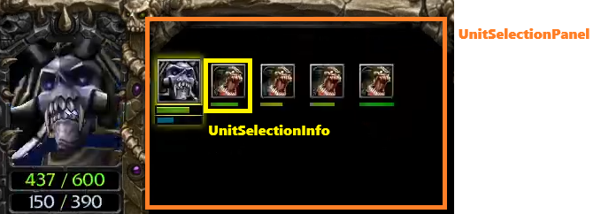

Good UI is Crucial for an RTS-Style game. I'm going to create a RTS-style unit selection board so that it is easy for the player to check each selected unit's status.

# Architecture

We need to use nested Widget architecture for reusability.

## 1. UnitSelectionInfo
