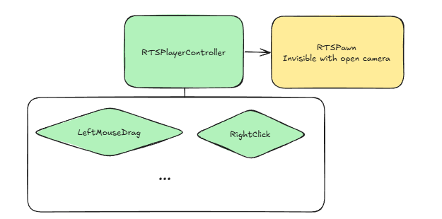

I want to create a RTS-Style commander view in UE5 that will make it easier to control multiple units.

This kind of controller is usually implemented on an **invisible pawn**

- A pawn with no mesh and only camera, located at the sky.

# 1. Create Unit Control Channel

I want to create a channel where only controllable units are blocked, so that our mouse trace channel detects the units we can select.

- `Edit->Project Settings->Collision->New Trace Channel`

