I want to create a RTS-Style commander view in UE5 that will make it easier to control multiple units.


This kind of controller is usually implemented on an **invisible pawn**

- A pawn with no mesh and only camera, located at the sky.

# 1. Create Unit Control Channel

I want to create a channel where only controllable units are blocked, so that our mouse trace channel detects the units we can select.

- `Edit->Project Settings->Collision->New Trace Channel`

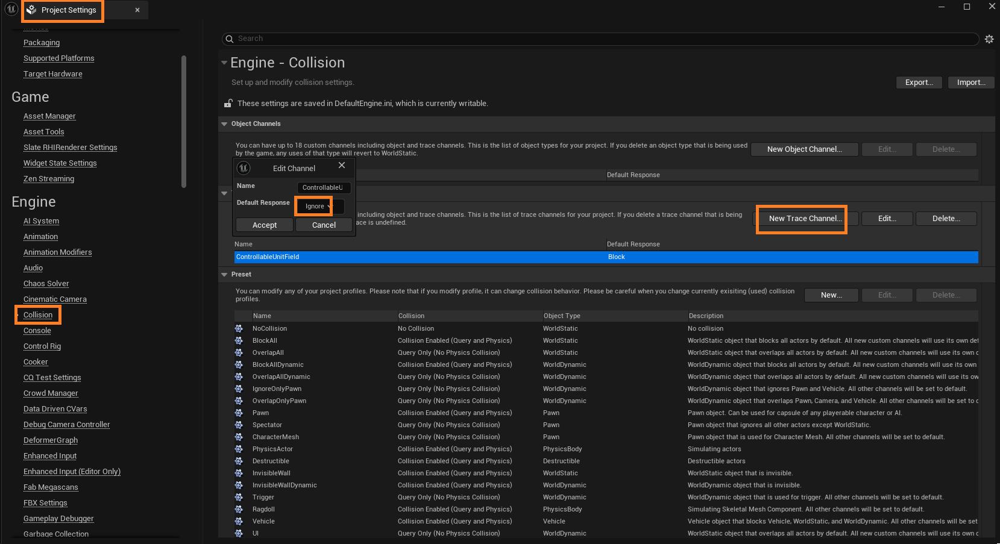

# 2. Create Selection Ring DecalComponent

Just like Starcraft, I want to create a ring UI around selected units so it is easy to see which units are currently selected.

## 2-1. Create a DecalComponent Class

```cpp
#pragma once

#include "CoreMinimal.h"
#include "Components/DecalComponent.h"
#include "SelectionDecal.generated.h"


UCLASS(ClassGroup=(Custom), meta=(BlueprintSpawnableComponent))
class FORBIDDENTACTICS_API USelectionDecal : public UDecalComponent
{
	GENERATED_BODY()

public:
	// Sets default values for this component's properties
	USelectionDecal();

protected:
	// Called when the game starts
	virtual void BeginPlay() override;

public:
	// Called every frame
	virtual void TickComponent(float DeltaTime, ELevelTick TickType,
	                           FActorComponentTickFunction* ThisTickFunction) override;
};
```

## 2-2. Create a Ring Material In Material Editor

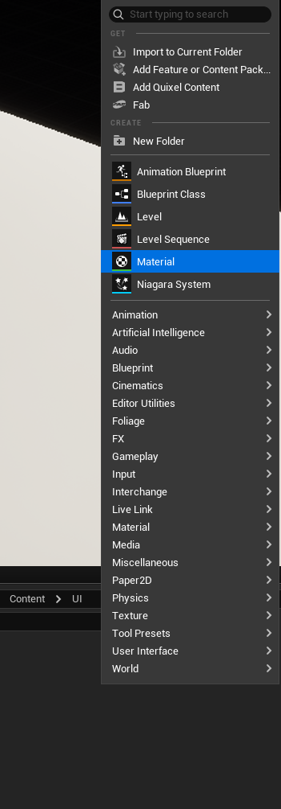

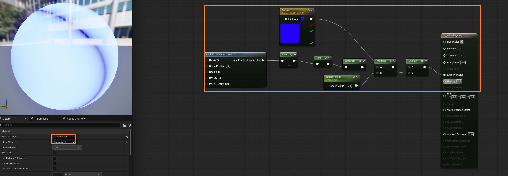

## 2-3. Create a BP Decal Component Class of the one we made in 2-1.

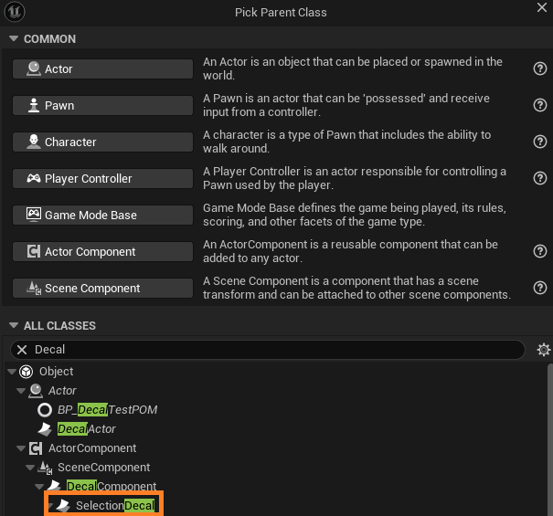

- Set Decal Material to the material we made

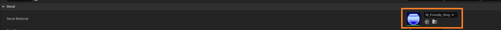

## 2-4. Add the Decal Component To Our Character

```cpp
// TacticsBaseUnit.h
#pragma once

#include "CoreMinimal.h"
#include "CharacterStatsComponent.h"
#include "TurnTimerComponent.h"
#include "GameFramework/Pawn.h"
#include "TacticsBaseUnit.generated.h"

UCLASS()
class FORBIDDENTACTICS_API ATacticsBaseUnit : public APawn
{
	GENERATED_BODY()

public:
	// Sets default values for this pawn's properties
	ATacticsBaseUnit();

protected:
	// Called when the game starts or when spawned
	virtual void BeginPlay() override;

public:
	// Called every frame
	virtual void Tick(float DeltaTime) override;

	// Called to bind functionality to input
	virtual void SetupPlayerInputComponent(class UInputComponent* PlayerInputComponent) override;

	bool IsPlayerSide() const { return PlayerTeam; }
	void SetIsSelected(bool bIsSelected);

private:
	static constexpr int DEFAULT_TURN_MILLISECOND = 1500;
	static constexpr float DECAL_DEPTH = 32.0f;
	static constexpr float DECAL_RADIUS = 64.0f;

	UPROPERTY(VisibleAnywhere, BlueprintReadWrite, Category = "Turn Timer", meta = (AllowPrivateAccess = "true"))
	TObjectPtr<UTurnTimerComponent> TurnTimer;

	UPROPERTY(VisibleAnywhere, BlueprintReadWrite, Category = "Character Stats", meta = (AllowPrivateAccess = "true"))
	TObjectPtr<UCharacterStatsComponent> Stats;

	UPROPERTY(VisibleAnywhere, BlueprintReadWrite, Category = "Tactics", meta = (AllowPrivateAccess = "true"))
	USkeletalMeshComponent* SkeletalMesh;

	UPROPERTY(EditDefaultsOnly, BlueprintReadWrite, Category = "Decal Component", meta = (AllowPrivateAccess = "true"))
    class USelectionDecal* SelectionRing;

	bool IsSelected = false;
	bool PlayerTeam = true;
};


// TacticsBaseUnit.cpp
ATacticsBaseUnit::ATacticsBaseUnit()
{
	// Set this pawn to call Tick() every frame.  You can turn this off to improve performance if you don't need it.
	PrimaryActorTick.bCanEverTick = true;

	UCapsuleComponent* Capsule = CreateDefaultSubobject<UCapsuleComponent>(FName("Capsule"));
	Capsule->SetCollisionEnabled(ECollisionEnabled::QueryAndPhysics);
    Capsule->SetCollisionResponseToChannel(ATacticsPlayerController::UNIT_CHANNEL, ECR_Block);
	Capsule->SetCapsuleRadius(22.0f);
	Capsule->SetCapsuleHalfHeight(50.0f);
	SetRootComponent(Capsule);

	TurnTimer = CreateDefaultSubobject<UTurnTimerComponent>("TurnTimer");
	SkeletalMesh = CreateDefaultSubobject<USkeletalMeshComponent>("SkeletalMesh");
	SelectionRing = CreateDefaultSubobject<USelectionDecal>("SelectionDecal");

	SelectionRing->SetRelativeRotation(FRotator(90, 0, 0));
	SelectionRing->DecalSize = FVector(DECAL_DEPTH, DECAL_RADIUS, DECAL_RADIUS);

	SkeletalMesh->SetupAttachment(RootComponent);

	SelectionRing->SetupAttachment(SkeletalMesh);
	SkeletalMesh->SetReceivesDecals(false);
}

// Called every frame
void ATacticsBaseUnit::Tick(float DeltaTime)
{
	Super::Tick(DeltaTime);
}

// Called to bind functionality to input
void ATacticsBaseUnit::SetupPlayerInputComponent(UInputComponent* PlayerInputComponent)
{
	Super::SetupPlayerInputComponent(PlayerInputComponent);
}

void ATacticsBaseUnit::SetIsSelected(bool bIsSelected)
{
	IsSelected = bIsSelected;
	SelectionRing->SetVisibility(bIsSelected);
}
```

- Now we add a skeletalmesh and set Decal Component as the ring component we made.

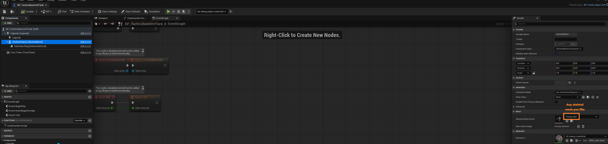

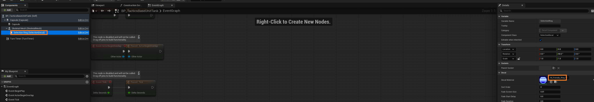

- Put unit on the map and we should see the selection ring.

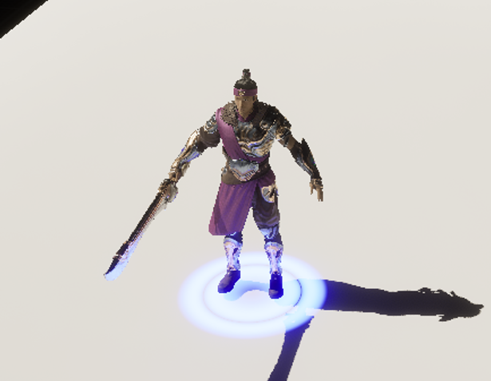

# 3. Add Drag/Click Unit To PlayerController

- We need a way of selecting units to control. Like in starcraft, we will implement click and drag units. These seem similar but operate on two different logics.
  - for click: We translate screen coordinate to world -> then shoot line trace.
  - for drag: We translate units to screen coordinate -> then get all units in the drag box.

## 3-1. Create Click Input Action/Input Mapping Context

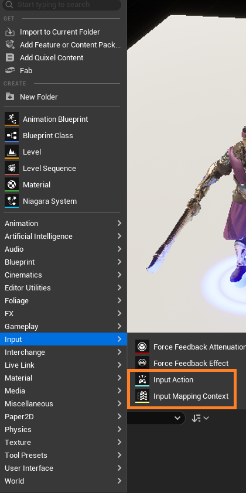

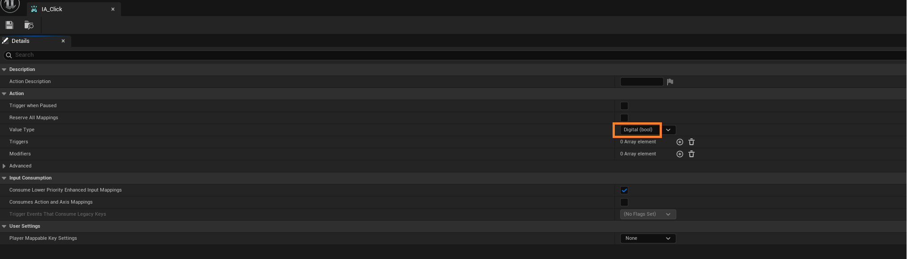

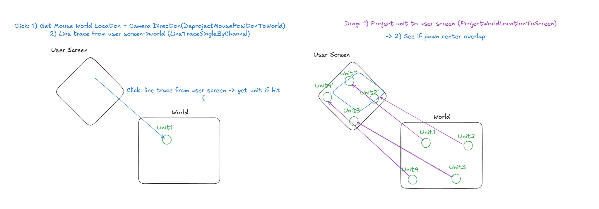

## 3-2. Add Click/Drag Trigger Functions

```cpp
// TacticsPlayerController.h
#pragma once

#include "CoreMinimal.h"
#include "ForbiddenTactics/Unit/TacticsBaseUnit.h"
#include "GameFramework/PlayerController.h"
#include "TacticsPlayerController.generated.h"

DECLARE_LOG_CATEGORY_EXTERN(LogTacticsController, Log, All);

struct FInputActionValue;
class UInputMappingContext;
class UInputAction;

/**
 *
 */
UCLASS()
class FORBIDDENTACTICS_API ATacticsPlayerController : public APlayerController
{
	GENERATED_BODY()

	ATacticsPlayerController();

protected:
	virtual void BeginPlay() override;
	virtual void SetupInputComponent() override;
	virtual void Tick(float DeltaTime) override;

public:
	static constexpr ECollisionChannel UNIT_CHANNEL = ECC_GameTraceChannel1;
private:
	const uint8 MAX_UNITS = 4;
	static constexpr float TRACE_LINE_LENGTH = 5000.0f;
	static constexpr float DRAG_MIN_DISTANCE = 10.0f;

	FVector2D MouseDragStart;
	FVector2D MouseDragEnd;

	bool IsClicking = false;
	bool IsDragging = false;

	UFUNCTION()
	void OnLeftMousePressed(const FInputActionValue& Value);

	UFUNCTION()
	void OnLeftMouseReleased(const FInputActionValue& Value);

	void ClearSelectedUnits();

	void SelectUnitClicked();
	void SelectUnitsInDraggedRegion();
	void SelectUnit(ATacticsBaseUnit* Unit);

	bool IsInDragBox(const FVector2D& UnitScreenLocation) const;

	TArray<TObjectPtr<ATacticsBaseUnit>> SelectedUnits;

	UPROPERTY(EditDefaultsOnly, Category="Input Mappings", meta = (AllowPrivateAccess = "true"))
	TObjectPtr<UInputMappingContext> IMC_ControlUnit;

	UPROPERTY(EditDefaultsOnly, Category="Input Mappings", meta = (AllowPrivateAccess = "true"))
	TObjectPtr<UInputAction> IA_ClickStart;

	UPROPERTY(EditDefaultsOnly, Category="Input Mappings", meta = (AllowPrivateAccess = "true"))
	TObjectPtr<UInputAction> IA_ClickEnd;

	TArray<TObjectPtr<ATacticsBaseUnit>> TotalUnits;
};


// TacticsPlayerController.cpp
// Fill out your copyright notice in the Description page of Project Settings.


#include "TacticsPlayerController.h"
#include "EnhancedInputComponent.h"
#include "EnhancedInputSubsystems.h"
#include "Kismet/GameplayStatics.h"

DEFINE_LOG_CATEGORY(LogTacticsController);

ATacticsPlayerController::ATacticsPlayerController()
{
	TotalUnits.Reserve(MAX_UNITS);
	SelectedUnits.Reserve(MAX_UNITS);

	TArray<AActor*> AllUnits;

	UGameplayStatics::GetAllActorsOfClass(GetWorld(), ATacticsBaseUnit::StaticClass(), AllUnits);

	for (AActor* Unit : AllUnits)
	{
		if (ATacticsBaseUnit* BaseUnit = Cast<ATacticsBaseUnit>(Unit))
		{
			if (BaseUnit->IsPlayerSide())
			{
				TotalUnits.Add(BaseUnit);
			}
		}
	}
}

void ATacticsPlayerController::BeginPlay()
{
	Super::BeginPlay();

	SetShowMouseCursor(true);

	if (ULocalPlayer* LocalPlayer = GetLocalPlayer())
	{
		if (UEnhancedInputLocalPlayerSubsystem* Subsystem = LocalPlayer->GetSubsystem<UEnhancedInputLocalPlayerSubsystem>())
		{
			if (IMC_ControlUnit)
			{
				Subsystem->AddMappingContext(IMC_ControlUnit, 0);
			}
		}
	}
}

void ATacticsPlayerController::SetupInputComponent()
{
	Super::SetupInputComponent();

	if (UEnhancedInputComponent* EnhancedInput = Cast<UEnhancedInputComponent>(InputComponent))
	{
		if (!IA_ClickStart)
		{
			UE_LOG(LogTacticsController, Error, TEXT("Cannot find IA_ClickStart"));
		}
		if (!IA_ClickEnd)
		{
			UE_LOG(LogTacticsController, Error, TEXT("Cannot find IA_ClickEnd"));
		}

		EnhancedInput->BindAction(
			IA_ClickStart,
			ETriggerEvent::Completed,
			this,
			&ATacticsPlayerController::OnLeftMousePressed
		);
		EnhancedInput->BindAction(
			IA_ClickEnd,
			ETriggerEvent::Completed,
			this,
			&ATacticsPlayerController::OnLeftMouseReleased
		);
	}
}

void ATacticsPlayerController::Tick(float DeltaTime)
{
	if (IsClicking)
	{
		GetMousePosition(MouseDragEnd.X, MouseDragEnd.Y);

		if (FVector2D::Distance(MouseDragStart, MouseDragEnd) >= DRAG_MIN_DISTANCE)
		{
			IsDragging = true;
		}
	}
}

void ATacticsPlayerController::OnLeftMousePressed(const FInputActionValue& Value)
{
	IsClicking = true;
	GetMousePosition(MouseDragStart.X, MouseDragStart.Y);
}

void ATacticsPlayerController::OnLeftMouseReleased(const FInputActionValue& Value)
{
	CHECK(IsClicking);
	ClearSelectedUnits();

	if (!IsDragging)
	{
		SelectUnitClicked();
	} else
	{
		SelectUnitsInDraggedRegion();
	}

	IsClicking = false;
	IsDragging = false;
}

void ATacticsPlayerController::ClearSelectedUnits()
{
	for (ATacticsBaseUnit* Unit : SelectedUnits)
	{
		Unit->SetIsSelected(false);
	}

	SelectedUnits.Empty();
}

void ATacticsPlayerController::SelectUnitClicked()
{
	FVector MouseWorldLocation;
	FVector ActorCameraDirection = GetPawn()->GetActorForwardVector();

	UE_LOG(LogTacticsController, Display, TEXT("In clicked"));
	UE_LOG(LogTacticsController, Display, TEXT("Unit #:%d"), TotalUnits.Num());

	if (!DeprojectMousePositionToWorld(MouseWorldLocation, ActorCameraDirection))
	{
		UE_LOG(LogTacticsController, Error, TEXT("Cannot DeprojectMousePositionToWorld"));
		return;
	}

	FVector TraceEnd = MouseWorldLocation + TRACE_LINE_LENGTH * ActorCameraDirection;
	FHitResult HitResult;

	GetWorld()->LineTraceSingleByChannel(HitResult, MouseWorldLocation, TraceEnd, UNIT_CHANNEL);

	if (!HitResult.GetActor())
	{
		return;
	}

	if (ATacticsBaseUnit* Unit = Cast<ATacticsBaseUnit>(HitResult.GetActor()))
	{
		SelectUnit(Unit);
	}
}

void ATacticsPlayerController::SelectUnitsInDraggedRegion()
{
	TArray<FVector2D> UnitScreenLocations;
	UnitScreenLocations.Reserve(TotalUnits.Num());

	UE_LOG(LogTacticsController, Display, TEXT("In drag"));
	UE_LOG(LogTacticsController, Display, TEXT("Unit #:%d"), TotalUnits.Num());
	for (ATacticsBaseUnit* Unit : TotalUnits)
	{
		if (!Unit)
		{
			UE_LOG(LogTacticsController, Error, TEXT("Null Unit In SelectUnitsInDraggedRegion"));
		}

		FVector2D UnitScreenLocation;

		if (!ProjectWorldLocationToScreen(Unit->GetActorLocation(), UnitScreenLocation))
		{
			UE_LOG(LogTacticsController, Error, TEXT("Cannot ProjectWorldLocationToScreen: Unit %s"), *Unit->GetName());
		}

		if (IsInDragBox(UnitScreenLocation))
		{
			SelectUnit(Unit);
		}
	}
}

void ATacticsPlayerController::SelectUnit(ATacticsBaseUnit* Unit)
{
	SelectedUnits.Add(Unit);
	Unit->SetIsSelected(true);
}


bool ATacticsPlayerController::IsInDragBox(const FVector2D& UnitScreenLocation) const
{
	const float MinX = MouseDragStart.X > MouseDragEnd.X ? MouseDragEnd.X : MouseDragStart.X;
	const float MaxX = MouseDragStart.X > MouseDragEnd.X ? MouseDragStart.X : MouseDragEnd.X;

	const float MinY = MouseDragStart.Y > MouseDragEnd.Y ? MouseDragEnd.Y : MouseDragStart.Y;
    const float MaxY = MouseDragStart.Y > MouseDragEnd.Y ? MouseDragStart.Y : MouseDragEnd.Y;

	return (UnitScreenLocation.X >= MinX && UnitScreenLocation.X <= MaxX) &&
		(UnitScreenLocation.Y >= MinY && UnitScreenLocation.Y <= MaxY);
}
```

- Also I changed `SetIsSelected` in TacticsBaseUnit to set visibility of the DecalComponent as well:

```cpp

void ATacticsBaseUnit::SetIsSelected(bool bIsSelected)
{
	IsSelected = bIsSelected;
	SelectionRing->SetVisibility(false);
}
```

# 4. Testing

Putting two actors and testing shows that it works as I intended:

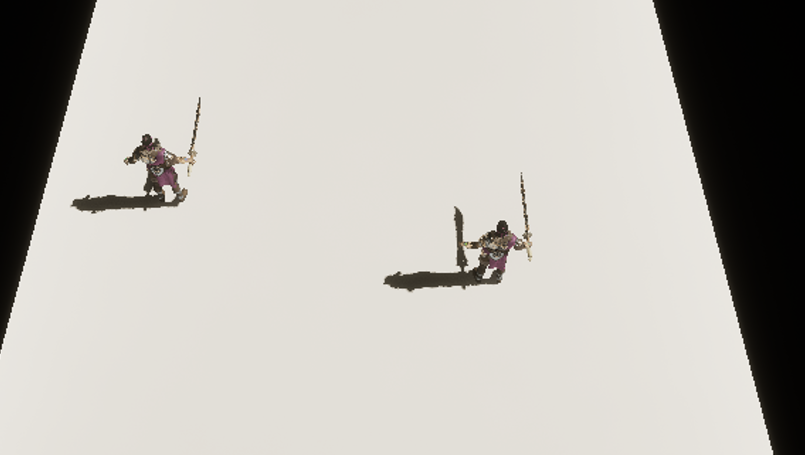

---

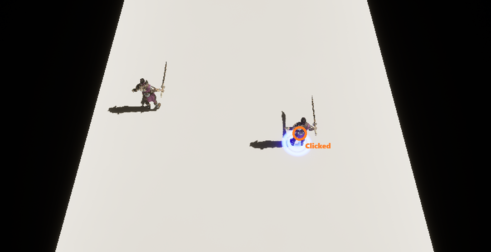

---

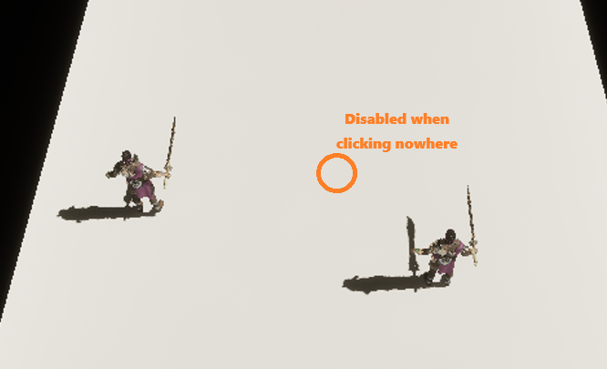

---

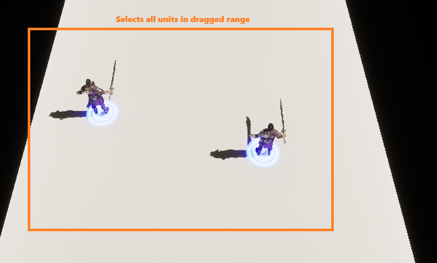
