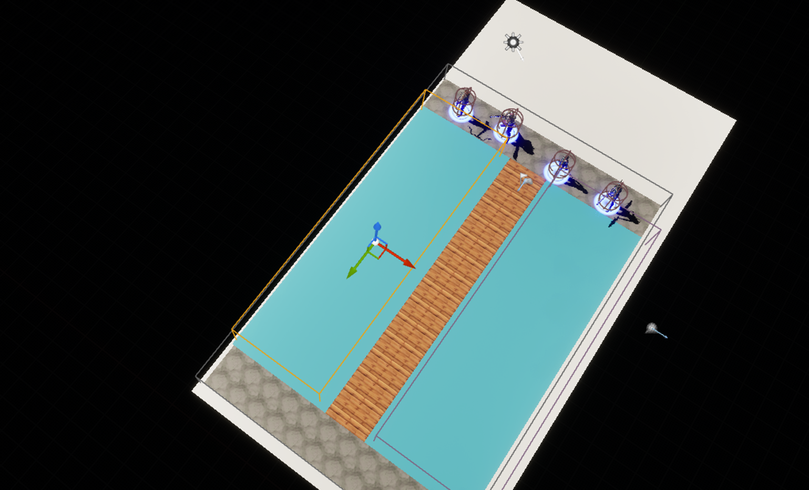
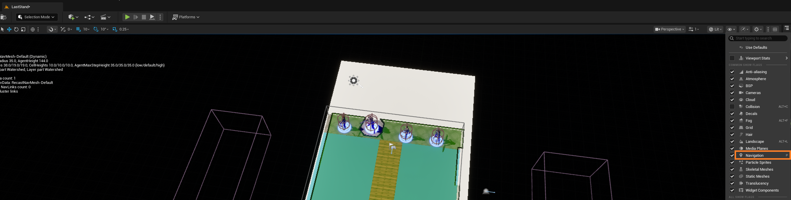
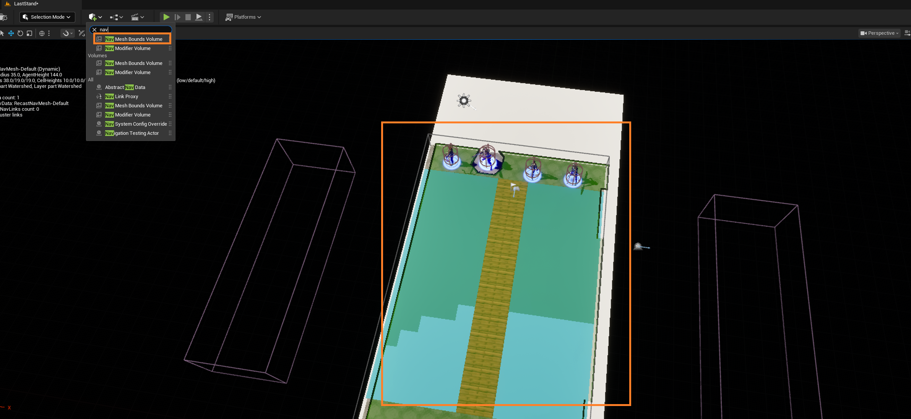
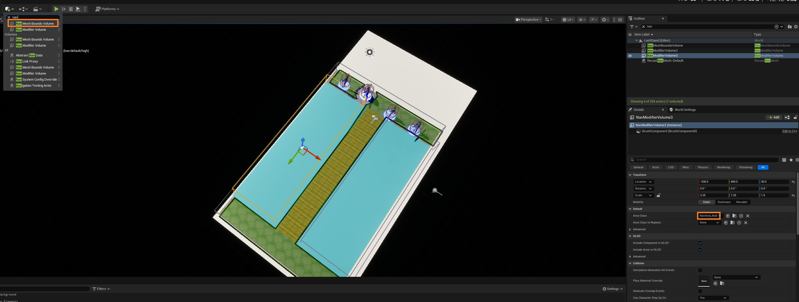
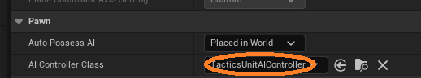
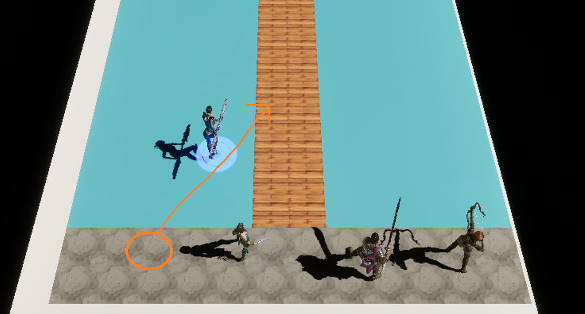

I want to set navigation so that the water area isn't movable and only the bridge-stone is movable



Turn on "Navigation" to see the green nav visual.



# 1. Create a default nav volume surrounding the whole map.



# 2. Create a null nav volume on the water



# 3. Create an AI Controller That Posseses the Units

- Needs `AIModule` in Build.cs

```cpp
// Fill out your copyright notice in the Description page of Project Settings.

#pragma once

#include "CoreMinimal.h"
#include "Runtime/AIModule/Classes/AIController.h"
#include "TacticsUnitAIController.generated.h"

UCLASS()
class FORBIDDENTACTICS_API ATacticsUnitAIController : public AAIController
{
	GENERATED_BODY()

public:
	// Sets default values for this actor's properties
	ATacticsUnitAIController();

protected:
	// Called when the game starts or when spawned
	virtual void BeginPlay() override;

public:
	// Called every frame
	virtual void Tick(float DeltaTime) override;
};
```

- Assign it to each unit.



There's one problem: The units get blocked when I click a null area, but they pass the water when I make them move to a target that has water between the line directory



It's probably because **I gave the units vector movement instead of AI navigation.**

- We need to change

```cpp
void ATacticsBaseUnit::Tick(float DeltaTime)
{
    Super::Tick(DeltaTime);
    UpdateSpeed();

	if (HasTarget) {
		if (ArrivedAtTarget()) {
			HasTarget = false;
			FloatingPawnMovement->MaxSpeed = 0.0f;
		}
		AddMovementInput(TargetLocation - GetActorLocation(), CharacterSpeed);
		FloatingPawnMovement->MaxSpeed = CharacterSpeed;
	}
}
```

to AIController APIs

```cpp
void ATacticsBaseUnit::MoveToTarget(const FVector& TargetLocation)
{
	AAIController* Controller = Cast<AAIController>(GetController());
	CHECK(Controller);

	FAIMoveRequest Req;
	Req.SetGoalLocation(TargetLocation);
	Req.SetAcceptanceRadius(10.0f);
	Controller->MoveTo(Req);
}
```
