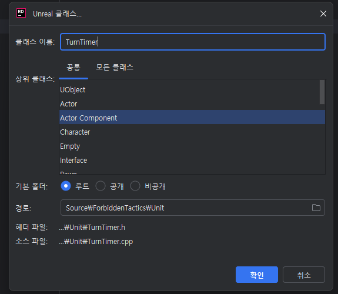

I'm trying to make a real-time turn-based system for UE5.

The first step is implementing a timer. Every controllable character will get this timer component and notify the game mode that their turn is here when the timer expires.

# 1. Create an ActorComponent named TurnTimer

