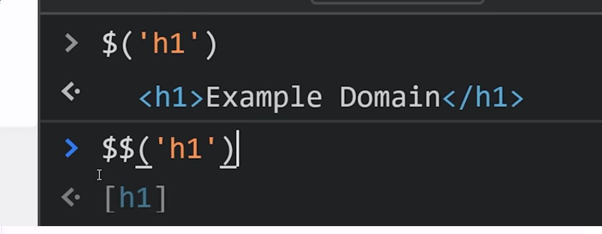
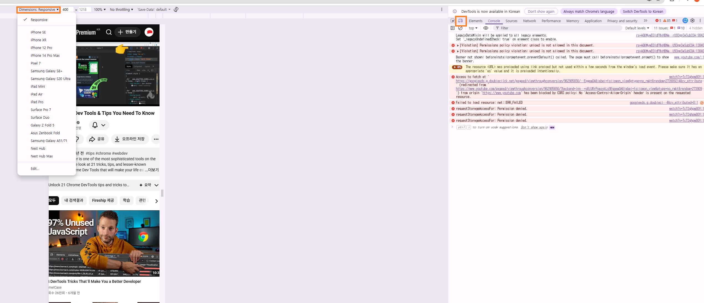
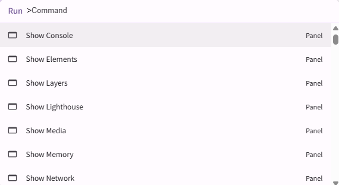
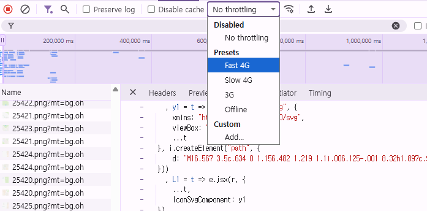
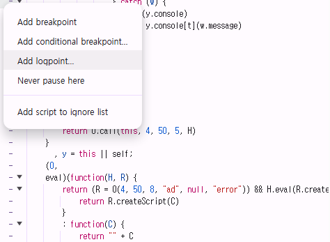
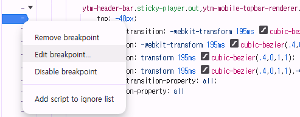

I always wanted to find out how to use develper tools well for debugging web pages, and I finally had the time to look into it.

# Dev Tools - We can execute commands in browser using Console

- $: find one matching query
- $$: find all matching query
- $0: get the current selected element in the `Elements` tab.

# Responsive

The **Toggle Device Toolbar** (Ctrl+Shift+M) lets you simulate different screen sizes and devices directly in the browser. You can:

- Pick from preset devices (iPhone, iPad, Pixel, etc.) or set a custom resolution
- Throttle the CPU and network to simulate mobile conditions
- Test media queries visually by dragging the viewport edge

This is the fastest way to catch layout bugs before deploying to real devices.

---

# Command Menu — DevTools Search Bar

Press **Ctrl+Shift+P** (Cmd+Shift+P on Mac) while DevTools is open to bring up the Command Menu. Think of it as a spotlight search for DevTools.

Useful things you can type:

- `screenshot` → capture a full-page or node screenshot without any extensions
- `coverage` → open the Coverage tab to find unused JS/CSS
- `dark` / `light` → switch DevTools color theme
- `disable cache` → toggle cache without touching Settings

---

# Network Tab — Throttling and Cache Control

The **Network** tab is essential for diagnosing slow pages:

- **Disable cache**: Check "Disable cache" while DevTools is open — simulates a first-time visitor with no cached assets
- **Throttle network**: Use the dropdown (Fast 3G, Slow 3G, Offline) to test your site under poor connections
- **Filter by type**: Click XHR, JS, CSS, Img to narrow down requests

---

# Logpoints — Log Without Touching Your Code

In the **Sources** tab, instead of inserting `console.log` everywhere:

1. Open the file in Sources
2. Right-click a line number → **Add logpoint**
3. Type an expression like `"user:", user.id`

Chrome logs the value every time that line executes — no code changes, no redeploy needed.

---

# Coverage Tool — Find Unused CSS and JS

Open via Command Menu → type `coverage`, then click the record button and reload the page.

The tool shows you what percentage of each file was actually executed. Red bars mean unused code. This is the fastest way to identify bloated stylesheets or dead JavaScript that can be safely removed.

---

# Conditional Breakpoints — Stop Only When You Care

Regular breakpoints pause on every hit. Conditional breakpoints let you specify a condition:

1. Right-click a line number in **Sources** → **Add conditional breakpoint**
2. Enter an expression like `user.id === 42` or `items.length > 100`
3. Debugger only pauses when the condition is true

Huge time saver when debugging inside loops or frequently-called functions.

---

# Accessibility Panel — See What Screen Readers See

In the **Elements** tab, select a node, then open the **Accessibility** side panel. It shows:

- The element's role and computed accessible name
- Full accessibility tree hierarchy
- ARIA properties and whether they are valid

You can also go to **Rendering** (via Command Menu) → enable **Emulate vision deficiencies** to preview your page as users with color blindness or blurred vision would see it.
