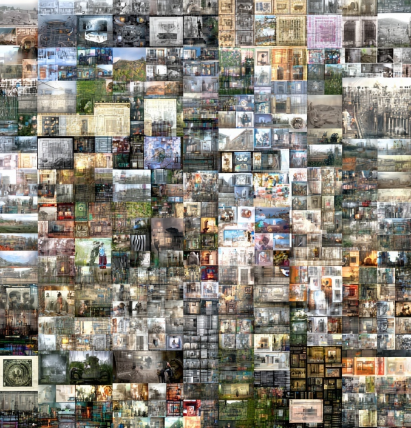
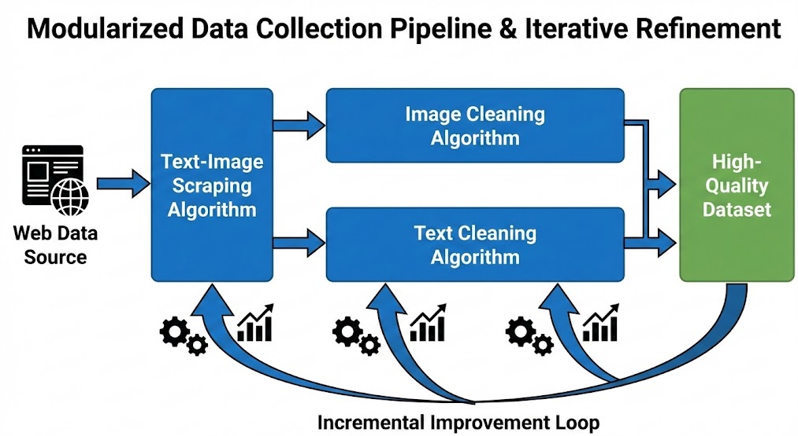
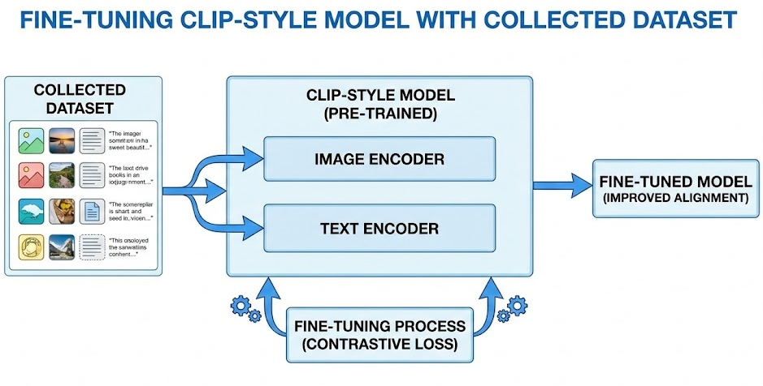

Multimodal understanding is a very hard but popular field in many companies. The ability to understand how relevant the title/description and the video/image content are can lead to a lot of good features that can help boost user experience such as filtering out bad content and recommending high-quality thumbnail that match the content of the blog/video post.

Making multimodal understanding model is already a challenging task; CLIP and SigLIP models only give us recall@top 5 in ImageNet of about 83%. What's even more challenging? Making one that is more specialized: that works for blog/clip posts specifically.

Training a model that understands multimodal content in Naver's blog and clip posts had a lot of additional hardships added to it:
_ **Expertise in Korean**: Probably less than 10% of all internet post in the world is done in Korean, and because of this, there isn't a good Korean specialized model that is available yet. Naver's blog/clip texts are 95% Korean. This meant that general Language Models can't be used directly, and needed more training to make it better at Korean first.
_ **Ability to Understand Vocabulary Related to Reviews**: User posts in Naver are highly focused on `review` of various things: TV shows, Products, Food, etc. This means that the models has to understand product/TV shows and map them to related keywords. \* ex) For posts written after mid-2025, the model needs to understand that `Demon Hunters` probably means the famous `K-Pop Demon Hunters` TV Show, not the actual meaning.

This requires the model to be fine-tuned on a big corpus of multimodal dataset to be collected, which is way harder than collecting text-only dataset that text-only Language Models use.

# 1. Collecting Data for Self-Supervised Training

AI models are intrinsically a statistical model. No matter how smart the model architecture is, it's never going to work if the data it is used to train on is noisy, messing up the characteristics we want the model to learn in our target population.

Collecting rich, high-quality data is always the hardest part of an AI project. 80% of our project was collecting and refining dataset to make a high-quality text-image pair.

We aimed on training a general-purpose model that can calculate the image-text relevance in all of Naver's content, so we collected data from different sources, such as Place, Videos, Blogs and Shopping

- Our first attempt was to scrape all the image and text description in user posts.

  - Although we were able to collect millions of image-text pairs easily, we soon found out that the pairs collected this way had very low quality.
  - The relevance between image and text was very low for many pairs(ex) a photo of meal with title `2025/04/03`)

- We modularized data collecting part into three parts:
  - Text-Image Scraping Algorithm
  - Image Cleaning Algorithm
  - Text Cleaning Algorithm

And kept incrementally improving each part of the pipeline to make higher quality dataset.

# 2. Fine-tuning CLIP-style Model With Collected Dataset

- After collecting and refining our multimodal dataset, we fine-tuned the biggest SigLIP model to our dataset.
  - fine-tuning a model that was trained for exactly the same purpose **maximized training efficiency. We weren't trying to make the model learn completely new things; we were just adjusting the statistic distribution of the original model's learned image-text vector space to fit our training data.**
  - as a result, the model trained very fast, reaching recall@top5 of 85% on 64 batch in only a few thousand steps.

These models provided strong baseline, but the models performed weak on texts that didn't directly represent something and needed reasoning, which we called `indirect texts`.

- ex) The model had a hard time finding that "My New Driver" had relationship with golf images.

This convinced us to scale up our target model size and use parts from bigger models which can better reason word's meanings.

# 3. Fine-Tuning Using Large VLM Parts

- Our team began using different popular VLMs to iteratively train and clean our dataset.
- This approach proved very effective, and our final model **reached 98% recall@top5 on 64 batch for our entire validation set.**

This model showed way better understanding of indirect texts.

# 4. Using the Model To Detect Spam/Ads In Different Contents

After succeeding in training a strong relevance model that understand Naver Posts' text and images, it was time to use this model to detect bad content in User posts.

We gathered benchmark dataset from different types of user posts:

- Blog
- Long Video
- Clips
- SNS Posts

And tuned hyperparameters for scoring logic of model outputs for each type of post. We were able to **achieve up to 15% increase in F1-score compared to as-is algorithm/models.**
